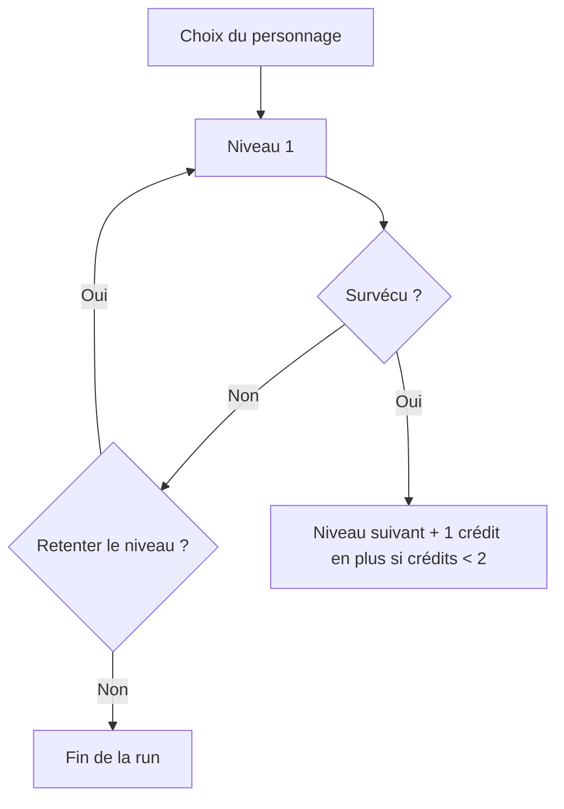

Idée de [[Chris]] pour le projet [[2D Game]] 

# **Pitch**
Un **beat 'em up vertical** qui reprend les codes des **jeux d'arcades** (ex: [Pretty Soldier Sailor Moon](https://en.wikipedia.org/wiki/Pretty_Soldier_Sailor_Moon_(arcade_game))). Chaque niveau rajoute des ennemis plus puissants et augmente également la barre de vie de notre personnage. On a accès a des items aléatoires apparaisssant sur l'écran de jeu (ex: pouvoir à temps limité, potion de vie). On a le choix entre plusieurs personnages lorsqu'on débute une run. Une run se termine à la mort de notre personnage et on recommence alors du début.

# Piliers

1. **Chaque personnage a ses avantages et ses faiblesses.** En choisissant un personnage, on choisit un certain nombre d'abilités et de technique qui lui sont propres et qui seront plus ou moins efficaces faces au différents ennemis. Mais on choisit également de faire avec les malus qui vont avec (ex: hitbox plus large, barre de vie réduite, etc.).
2. **Les runs sont infinies mais plus on avance, plus il difficile d'aller plus loin.**  La rejouabilité est ainsi garantie car même s'il est possible d'apprendre les patterns d'attaques, on ne peut pas prédire d'où l'ennemi apparait et quels nouveaux ennemis apparaîtront au prochain niveau.
3. **On peut jouer à deux.** Comme sur une borne d'arcade, on peut jouer seul ou accompagné. Bien évidemment, qui dit deux joueurs dit deux foix plus d'ennemis. Les joueurs peuvent choisir le même personnage ou deux personnages différents et la run s'arrête lorque qu'ils ont tous les deux perdu.
4. **On peut retenter un niveau.** On démarre avec 2 crédits (c'est le maximum). Un niveau gagné = un crédit (si on est en dessous de 2 crédits), un crédit = une nouvelle tentative pour un niveau perdu.

## Déroulement d'une run

## Niveaux

-  Chaque niveau est généré **aléatoirement** au niveau du placement des ennemis.
- Le type d'ennemi qui apparaît sera **prédéterminé** (plus le niveau est élevé, plus il y aura de types d'ennemis générés).
-  La run est **infinie**, on joue jusqu'a ce qu'on épuise ses crédits
-  Un boss tous les 5 niveaux.

## Difficulté

-  Plus on va loin dans la run, plus les ennemis sont **difficiles** (ex: hitbox plus petite, attaques plus puissantes, barre de vie plus grande).

## Récompenses et items

-  On démarre avec **2 crédits** (maximum) et un crédit peu être utilisé pour retenter un niveau. Chaque niveau terminé **en un essai** nous récompense d'un crédit (si on en a moins de 2.
- Des items apparaissent au long du niveau avec différentes **fonctionnalités**. Ceux-ci peuvent servir à la défense, à l'attaque, renflouer la barre de vie ou débloquer un **mode spécial** pour une durée **limitée** (dépendant du personnage choisi au début).

## Méta-progression (après la mort)

-  Plus on avance dans les niveaux, plus on débloque de **nouveaux personnages** à jouer pour la run suivante (ex: un boss battu = un nouveau personnage jouable).

## Pourquoi ça colle au projet (POO)

| **Élément du jeu**  | Piste de conception                           |
| ------------------- | --------------------------------------------- |
| Choix de personnage | Classe abstraite **Character** + sous-classes |
| Différents ennemis  | Classe abstraite **Ennemy** + sous-classes    |
| Items               | Classe abstraite **Equipment**                |
