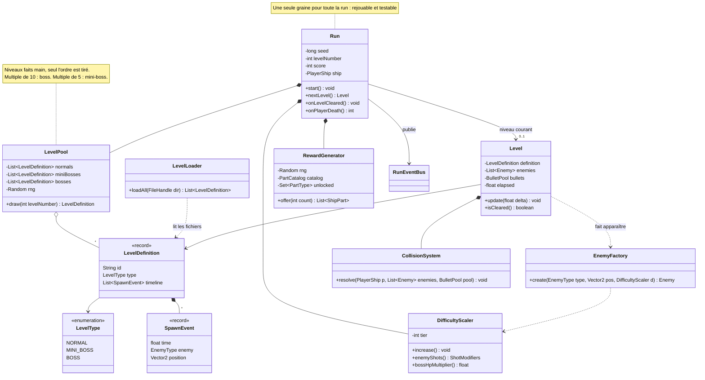
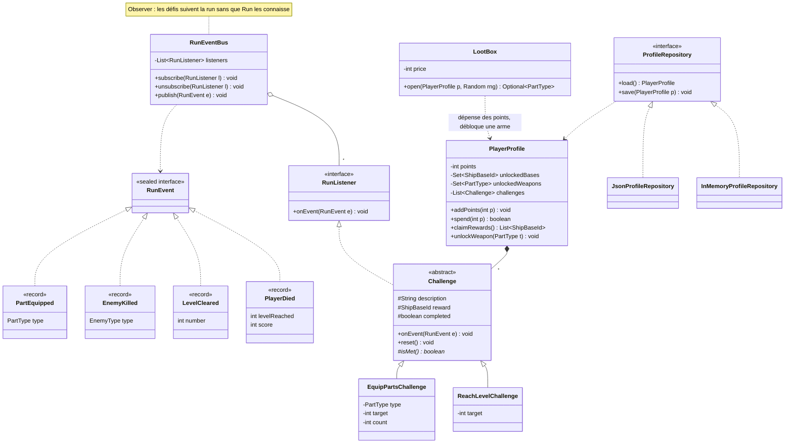
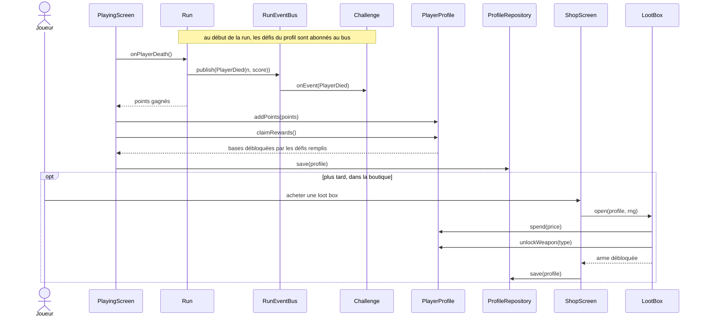
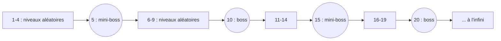
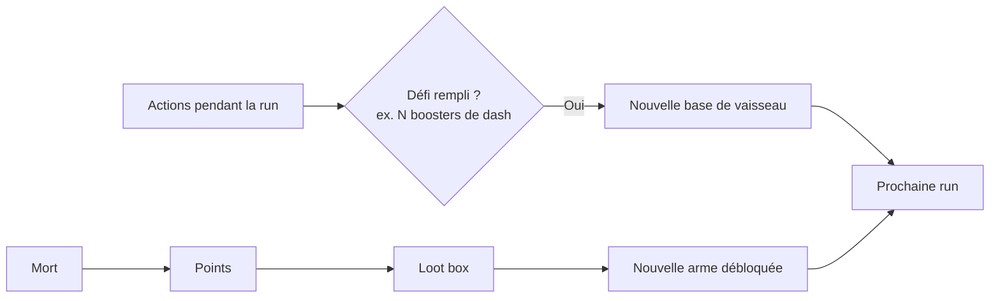

> [!warning] Mis de côté le 2026-11-24
> Pour finir dans les temps, le jeu est réduit à un **boss rush** (voir [[2D-Game/ideas/pierre/Bullet hell roguelike - UML|l'UML]]). Ces parties sont retirées de l'UML **temporairement**. Pour les remettre, recopier les sections ci-dessous à leur place et regénérer les images.

Ce qui a aussi été retiré ailleurs dans l'UML :

- §1 Cas d'utilisation : `UC7 Acheter une loot box` et `UC8 Voir ses déblocages` (reliés au joueur).
- §2 Paquets : le paquet `meta` (`PlayerProfile, Challenge, LootBox, RunEventBus`), avec `core --> meta`, `screen --> meta` et `meta --> ship`.
- §3.1 : `ShopScreen` (`BaseScreen <|-- ShopScreen`) et le champ `-PlayerProfile profile` de `BulletHellGame`.
- §3.4 : `DashBase` était débloquée par le défi des boosters de dash.
- §5.1 : l'état « Boutique » (`Menu --> Shop : Boutique`, `Shop --> Menu : Retour`), et `Over --> Menu : points et déblocages appliqués`.
- §6 : les patterns Observer (`RunEventBus` / `RunListener` / `Challenge`) et Repository (`ProfileRepository`).
- §7 : « À quoi servent les points ? » → seulement les loot box (armes) ; « Nombre de niveaux dans le pool » → au moins 20.
- Code : `run/RunEvent.java` et `run/RunListener.java`, écrits pendant le socle, ont été supprimés.

Images d'avant : [[2D-Game/ideas/pierre/assets/uml/07b-classes-niveaux-mis-de-cote.png|run et niveaux (PNG)]] · [[2D-Game/ideas/pierre/assets/uml/08-classes-meta.png|méta-progression (PNG)]] · [[2D-Game/ideas/pierre/assets/uml/11-sequence-mort.png|mort et déblocages (PNG)]]

## Ancienne §3.5 — niveaux normaux, mini-boss et boss

- `Run.nextLevel()` fait `levelNumber++`, `difficulty.increase()`, puis `pool.draw(levelNumber)`. C'est le « Difficulté +1 → niveau tiré au hasard » de la boucle de run.
- `LevelPool.draw()` tire sans remise. Quand le pool de niveaux normaux est vide, il le remélange. La partie peut donc durer à l'infini.
- `LevelPool` et `RewardGenerator` reçoivent un `Random` créé à partir de la graine de la run. Avec la même graine, les tests obtiennent les mêmes niveaux et les mêmes pièces.

## Ancienne §3.6 — Méta-progression

- Au début d'une run, `Run` remet à zéro les défis non remplis du profil et les abonne au bus.
- Exemple : `EquipPartsChallenge(DASH_BOOSTER, 5)` compte les `PartEquipped(DASH_BOOSTER)`. À 5, il passe à `completed` et débloquera `DashBase`.
- `JsonProfileRepository` écrit le profil avec `Json` de LibGDX dans `Gdx.files.local()`. `InMemoryProfileRepository` sert aux tests : pas d'écriture sur le disque.

## Ancienne §4.3 — Mort et méta-progression

## Ancien game design — niveaux

- Les niveaux sont **créés à la main** à l'avance (patterns d'ennemis et de balles fixes).
- **Seul leur ordre est aléatoire.** À chaque run, on en tire un au hasard dans le pool.
- La partie est **infinie**. On joue jusqu'à la mort.
- Un **mini-boss tous les 5 niveaux** et un **boss tous les 10 niveaux**.

## Ancien game design — méta-progression

Il y a deux manières de débloquer du contenu :

| Ce qu'on débloque               | Comment                                               | Exemple                                                                                               |
| ------------------------------- | ----------------------------------------------------- | ----------------------------------------------------------------------------------------------------- |
| **Nouvelles bases de vaisseau** | En remplissant des **défis pendant une run**          | Équiper assez de boosters de dash en une partie débloque un vaisseau qui recharge ses dashs plus vite |
| **Nouvelles armes**             | Avec des **loot box** achetées avec les points gagnés (les points ne servent qu'à ça) | Une loot box donne une arme qui pourra ensuite apparaître dans les récompenses                        |
|                                 |                                                       |                                                                                                       |

## Anciennes réponses

- Les **points** obtenus à la mort servent **uniquement à acheter des loot box** (donc des armes).
- Il faut créer **au moins 20 niveaux** pour que l'ordre aléatoire reste varié.
- Pilier : « On progresse même en perdant. La mort débloque de nouveaux vaisseaux et de nouvelles armes. »
