UML de l'idée [[2D-Game/ideas/pierre/Bullet hell roguelike|Bullet hell roguelike — vaisseau modulaire]]. Ça couvre la partie UML de [[04 - Conception (GDD & UML)]].

Cible : Java 17 + LibGDX 1.13 (même base que `BOOTRAP_LibGDX`, package `com.mygame`). `MyFirstLibGDXGame` devient `BulletHellGame` et `GameScreen` devient `PlayingScreen`.

> [!note] Périmètre réduit le 2026-11-24 : boss rush
> Le jeu est un **enchaînement de boss**. Les niveaux normaux, les mini-boss et la méta-progression (défis, points, loot box, boutique) sont mis de côté dans [[2D-Game/ideas/pierre/Bullet hell roguelike - UML (mis de côté)|UML (mis de côté)]].

**Choix de départ : le modèle n'utilise que les classes de LibGDX qui marchent sans fenêtre** (`Vector2`, `Rectangle`, `Pool`). Les entités ne portent pas de `Texture`, seulement un `spriteId`. Les `Texture` et le `SpriteBatch` demandent un contexte OpenGL, donc ils restent dans `Renderer` et les écrans. On peut ainsi tester avec JUnit les collisions, la fusion, la difficulté et le tirage des niveaux sans ouvrir de fenêtre.

## 1. Cas d'utilisation

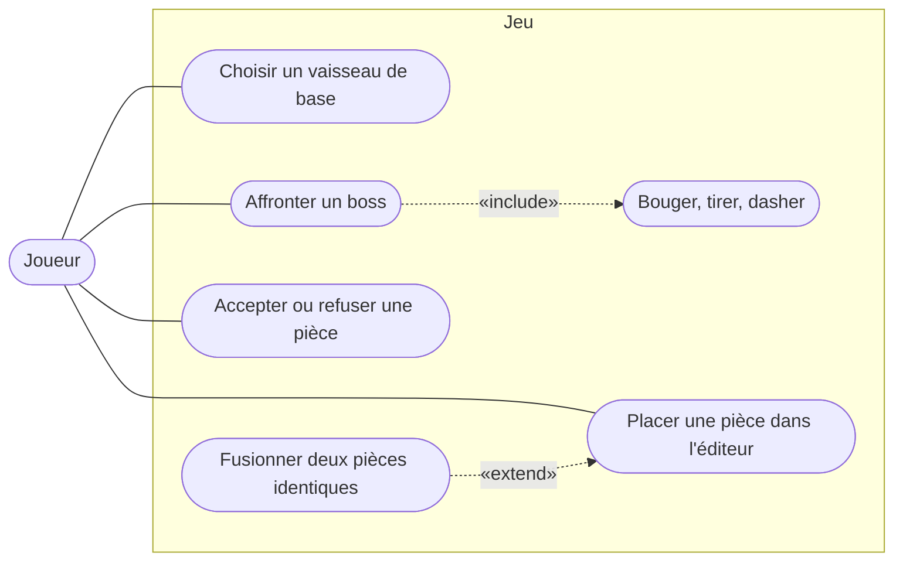

## 2. Paquets

Les flèches indiquent qui dépend de qui. `entity` ne connaît personne, et `PlayerShip` est rangé dans `ship` pour que `entity` ne dépende pas du vaisseau modulaire. Le seul cycle est voulu, entre `core` et `screen` : le jeu crée les écrans, et chaque écran garde une référence au jeu pour appeler `setScreen()`. C'est le fonctionnement normal de LibGDX.

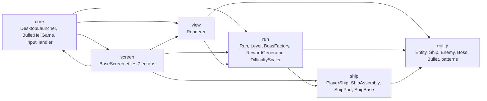

## 3. Diagrammes de classes

### 3.1 Moteur et écrans — State, Template Method

LibGDX fournit déjà le pattern State : `Game` garde un `Screen` courant et `setScreen()` en change. Chaque écran du jeu est un état.

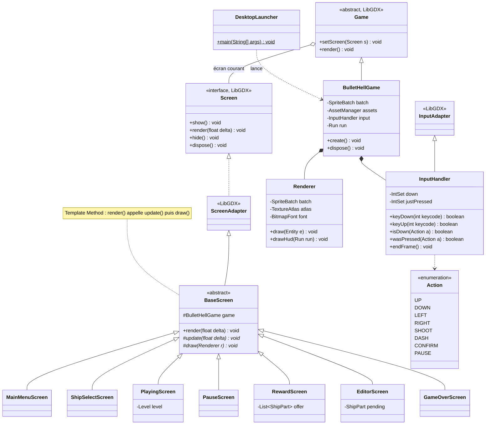

- `BaseScreen.render(delta)` est le même pour tous les écrans : il appelle `update(delta)`, efface l'écran, puis `draw(renderer)`. Chaque écran ne redéfinit que ces deux méthodes. On sépare ainsi la logique (testable) du dessin.
- `InputHandler` étend `InputAdapter` et est branché avec `Gdx.input.setInputProcessor()`. Il retient les touches enfoncées pour que `PlayerShip` les lise dans `update()`. Les touches sont associées à une `Action`, donc on peut changer les contrôles sans toucher au vaisseau.

### 3.2 Entités et collisions

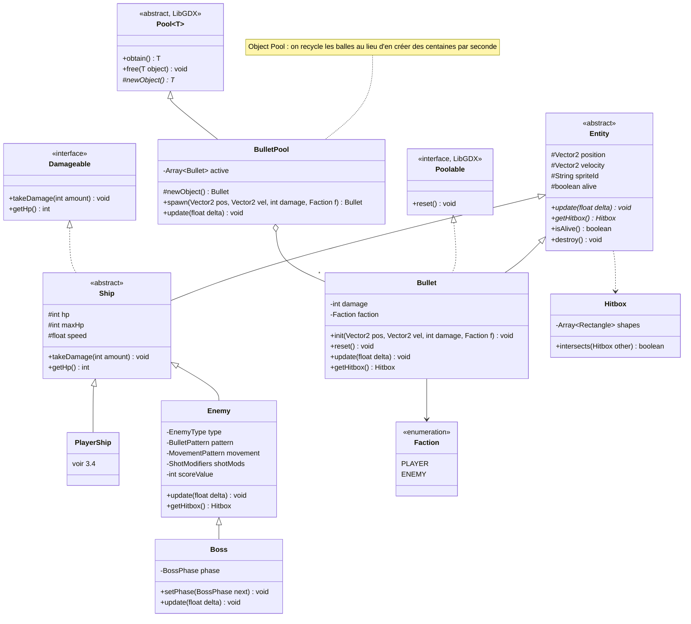

`BulletPool` s'appuie sur `Pool` de LibGDX : `spawn()` fait `obtain()` puis `init()`, et une balle sortie de l'écran ou qui a touché est rendue avec `free()`, qui appelle `reset()`. `Vector2`, `Rectangle` et `Array` sont aussi ceux de LibGDX. Ils marchent sans fenêtre, donc dans les tests.

### 3.3 Comportements des ennemis — Strategy, State

Les patterns de tir sont fixes et déterministes (même entrée, mêmes balles), donc apprenables. La difficulté passe par `ShotModifiers` (vitesse et dégâts), pas par de nouvelles attaques.

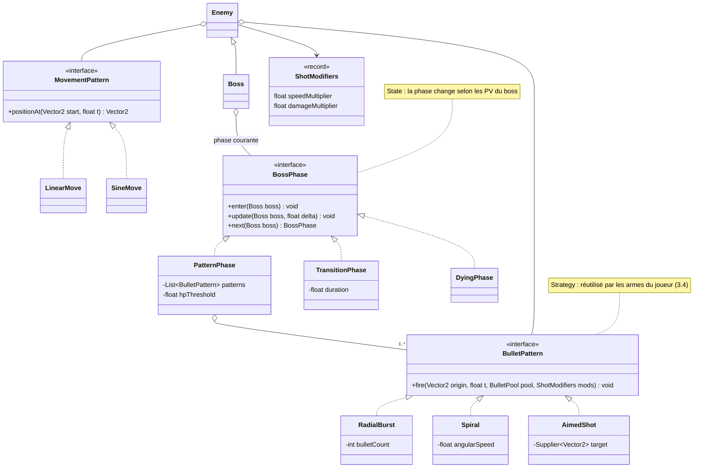

### 3.4 Vaisseau modulaire — Composite, Factory

Chaque pièce occupe une case de la grille. La hitbox du vaisseau est l'union des cases occupées. La grille fait de 3×3 à 5×5 selon la base de vaisseau. Fusionner des pièces identiques additionne leurs stats et libère des cases : 2 pièces de niveau 1 → niveau 2, 2 pièces de niveau 2 → niveau 3 (maximum).

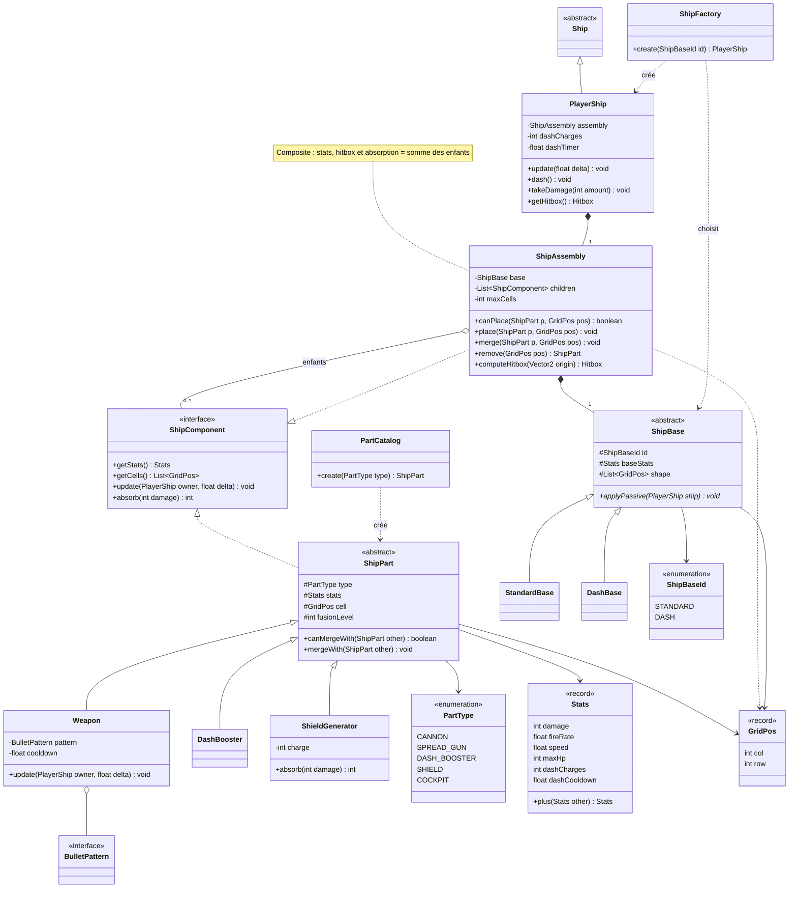

- `GridPos` est une case de la grille du vaisseau (`col`, `row`). C'est un `record` : deux `GridPos` aux mêmes coordonnées sont égales, ce qui permet de savoir si une case est déjà occupée.
- `mergeWith()` modifie la pièce elle-même (niveau + 1, stats additionnées avec `plus()`) au lieu d'en créer une nouvelle : comme `ShipPart` est abstraite, c'est la seule façon de garder la bonne sous-classe. `ShipAssembly.merge()` retire ensuite l'autre pièce et libère sa case.
- `CANNON` et `SPREAD_GUN` sont tous deux des `Weapon` : seul leur `BulletPattern` change. Ajouter une arme ne demande pas de nouvelle classe.
- `COCKPIT` est la **pièce de départ** : `ShipFactory.create()` la pose sur la case centrale de la base. C'est un `Weapon` avec **les mêmes stats et le même tir que `CANNON`**, seul son sprite change. Il n'y en a qu'**un seul** sur le vaisseau : `RewardGenerator` ne le propose jamais et `canMergeWith()` renvoie `false` pour lui. Une pièce posée ne se retire pas, donc il reste toujours sur le vaisseau.
- `PlayerShip.takeDamage()` passe d'abord les dégâts à `assembly.absorb()`. Les boucliers en retirent une partie, le reste touche les PV.
- `DashBase` est disponible dès le début, au choix avec `StandardBase` dans `ShipSelectScreen` : son `applyPassive()` réduit le temps de recharge du dash.

### 3.5 Run et boss rush

Une run est un enchaînement de boss. Après chaque boss vaincu : récompense, éditeur, puis le boss suivant, un peu plus difficile.

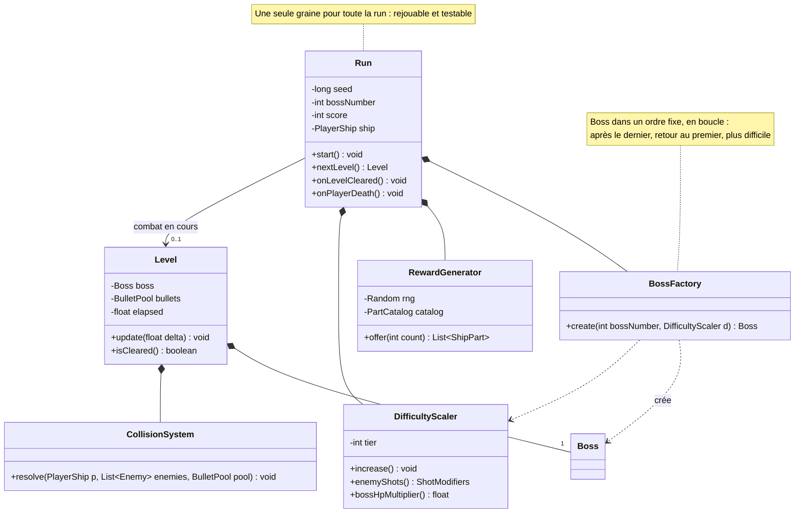

- `Run.nextLevel()` fait `bossNumber++`, `difficulty.increase()`, puis crée un `Level` avec `bossFactory.create(bossNumber, difficulty)`.
- `BossFactory` connaît la liste des boss : **1 seul boss pour l'instant** (la liste pourra grandir). Le boss `n` est le boss `(n - 1) % nombre de boss` de la liste : avec un seul boss, il revient à chaque fois, avec une difficulté plus haute. La partie dure jusqu'à la mort.
- `Level.isCleared()` est vrai quand le boss est mort. `Level` passe `List.of(boss)` à `CollisionSystem.resolve()`.
- `RewardGenerator` reçoit un `Random` créé à partir de la graine de la run : même graine, mêmes pièces proposées. Toutes les pièces peuvent tomber, sauf le `COCKPIT` (pièce de départ unique).
- Le score de la run est le nombre de boss vaincus.

## 4. Diagrammes de séquence

### 4.1 Une frame de jeu

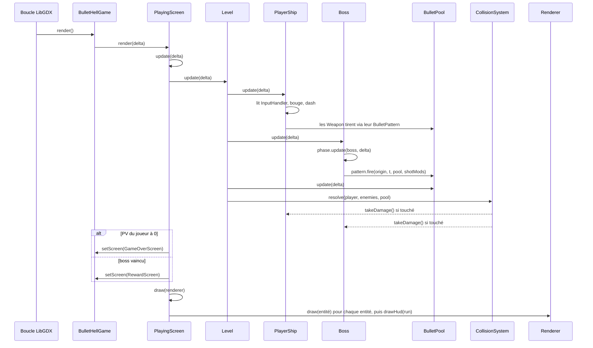

### 4.2 Boss vaincu : récompense, éditeur, fusion

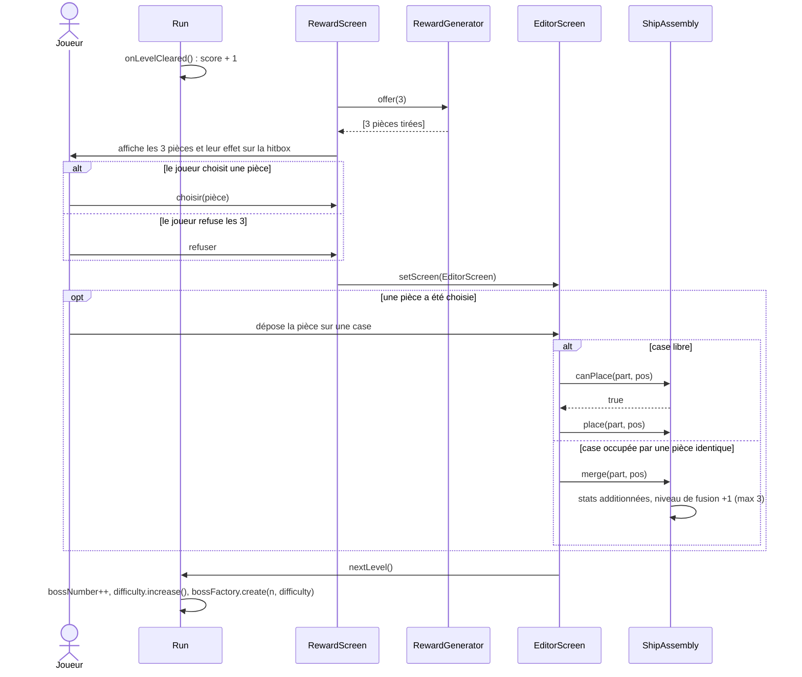

## 5. Diagrammes d'états

### 5.1 Écrans du jeu (`Screen`)

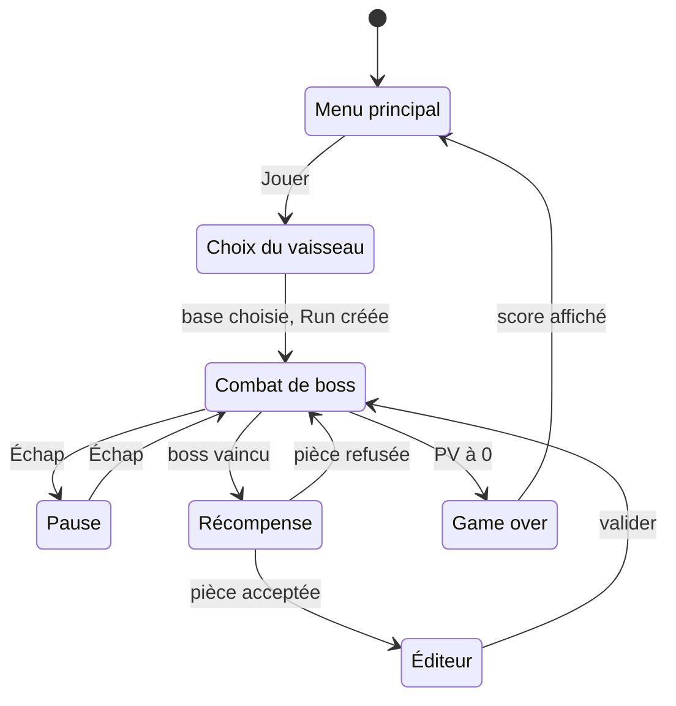

### 5.2 Phases d'un boss (`BossPhase`)

Exemple pour un boss à 3 phases. Les seuils de PV sont des exemples.

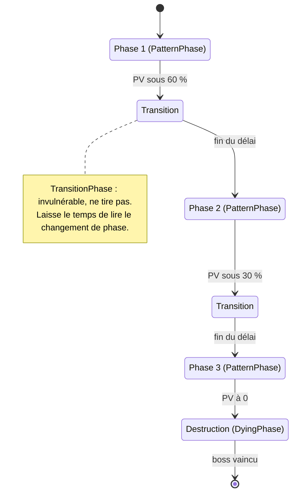

## 6. Patterns retenus

| Pattern     | Où                                             | Pourquoi                                                                                           |
| ----------- | ---------------------------------------------- | -------------------------------------------------------------------------------------------------- |
| State       | `BulletHellGame` / `Screen`                   | Fourni par LibGDX (`setScreen()`). Chaque écran a ses entrées, sa logique et son rendu, sans grand `switch`. |
| Template Method | `BaseScreen`                               | `render()` est commun : il appelle `update()` puis `draw()`, que chaque écran redéfinit.             |
| State       | `Boss` / `BossPhase`                           | Les phases changent selon les PV. Chaque phase est une classe qu'on peut tester seule.              |
| Strategy    | `BulletPattern`, `MovementPattern`             | Les ennemis et les armes du joueur partagent les mêmes patterns. Une nouvelle arme = un nouveau pattern. |
| Composite   | `ShipComponent` / `ShipAssembly` / `ShipPart`  | On traite le vaisseau entier comme une pièce : stats, hitbox et absorption sont la somme des enfants. |
| Factory     | `ShipFactory`, `PartCatalog`, `BossFactory`    | Un seul endroit crée les bases, les pièces gagnées et les boss ajustés à la difficulté.            |
| Object Pool | `BulletPool` (étend `Pool` de LibGDX)          | Des centaines de balles à l'écran : on les recycle au lieu d'en créer à chaque tir.                 |

## 7. Décisions de game design

Voir les réponses dans [[2D-Game/ideas/pierre/Bullet hell roguelike|l'idée]].

| Question                                   | Où ça se joue                                   | Décision                                          |
| ------------------------------------------ | ----------------------------------------------- | ------------------------------------------------- |
| Nombre de pièces proposées                 | `RewardGenerator.offer(int count)`              | **3**, on en choisit une                          |
| Limite de fusion                           | `ShipPart.canMergeWith()` vérifie `fusionLevel` | `MAX_FUSION = 3` (2 × niv. 1 → 2, 2 × niv. 2 → 3) |
| Taille maximale du vaisseau                | `ShipAssembly.maxCells` et `canPlace()`         | selon la base : de 3×3 à 5×5                      |
| Éditeur à chaque niveau ou après un boss ? | transition `Reward → Editor`                    | après chaque boss                                 |
| Ordre des boss                             | `BossFactory.create()`                          | fixe, en boucle, difficulté + 1 à chaque boss     |
| Les pièces ont-elles des PV ?              | `ShipPart` implémenterait `Damageable`          | *encore ouvert* (par défaut : non)                |

## 8. Exports (images)

Les 11 diagrammes sont exportés en SVG et en PNG (fond blanc) dans `assets/uml/`, pour le GDD et la soutenance. Ils ne se mettent pas à jour tout seuls : il faut les regénérer si on modifie un diagramme ci-dessus.

| #   | Diagramme                      | Fichiers                                                                                                   |
| --- | ------------------------------ | ---------------------------------------------------------------------------------------------------------- |
| 1   | Cas d'utilisation              | [[2D-Game/ideas/pierre/assets/uml/01-cas-utilisation.png\|PNG]] · [[2D-Game/ideas/pierre/assets/uml/01-cas-utilisation.svg\|SVG]] |
| 2   | Paquets                        | [[2D-Game/ideas/pierre/assets/uml/02-paquets.png\|PNG]] · [[2D-Game/ideas/pierre/assets/uml/02-paquets.svg\|SVG]] |
| 3   | Classes : moteur et écrans     | [[2D-Game/ideas/pierre/assets/uml/03-classes-moteur.png\|PNG]] · [[2D-Game/ideas/pierre/assets/uml/03-classes-moteur.svg\|SVG]] |
| 4   | Classes : entités              | [[2D-Game/ideas/pierre/assets/uml/04-classes-entites.png\|PNG]] · [[2D-Game/ideas/pierre/assets/uml/04-classes-entites.svg\|SVG]] |
| 5   | Classes : comportements        | [[2D-Game/ideas/pierre/assets/uml/05-classes-comportements.png\|PNG]] · [[2D-Game/ideas/pierre/assets/uml/05-classes-comportements.svg\|SVG]] |
| 6   | Classes : vaisseau modulaire   | [[2D-Game/ideas/pierre/assets/uml/06-classes-vaisseau.png\|PNG]] · [[2D-Game/ideas/pierre/assets/uml/06-classes-vaisseau.svg\|SVG]] |
| 7   | Classes : run et boss rush     | [[2D-Game/ideas/pierre/assets/uml/07-classes-run.png\|PNG]] · [[2D-Game/ideas/pierre/assets/uml/07-classes-run.svg\|SVG]] |
| 9   | Séquence : une frame           | [[2D-Game/ideas/pierre/assets/uml/09-sequence-frame.png\|PNG]] · [[2D-Game/ideas/pierre/assets/uml/09-sequence-frame.svg\|SVG]] |
| 10  | Séquence : boss vaincu         | [[2D-Game/ideas/pierre/assets/uml/10-sequence-fin-niveau.png\|PNG]] · [[2D-Game/ideas/pierre/assets/uml/10-sequence-fin-niveau.svg\|SVG]] |
| 12  | États : écrans                 | [[2D-Game/ideas/pierre/assets/uml/12-etats-ecrans.png\|PNG]] · [[2D-Game/ideas/pierre/assets/uml/12-etats-ecrans.svg\|SVG]] |
| 13  | États : phases d'un boss       | [[2D-Game/ideas/pierre/assets/uml/13-etats-boss.png\|PNG]] · [[2D-Game/ideas/pierre/assets/uml/13-etats-boss.svg\|SVG]] |
