UML de l'idée [[2D-Game/ideas/pierre/Bullet hell roguelike|Bullet hell roguelike — vaisseau modulaire]]. Ça couvre la partie UML de [[04 - Conception (GDD & UML)]].

Cible : Java 21 + JavaFX (même base que `bootrap_JavaFx`).

**Choix de départ : le modèle ne dépend pas de JavaFX.** Les entités ne portent pas d'`ImageView`, seulement un `spriteId`. C'est le `Renderer` qui les dessine. On peut donc tester avec JUnit les collisions, la fusion, la difficulté et le tirage des niveaux sans lancer l'interface. C'est une évolution par rapport au bootstrap, où `Entity` contient un `ImageView`.

## 1. Cas d'utilisation

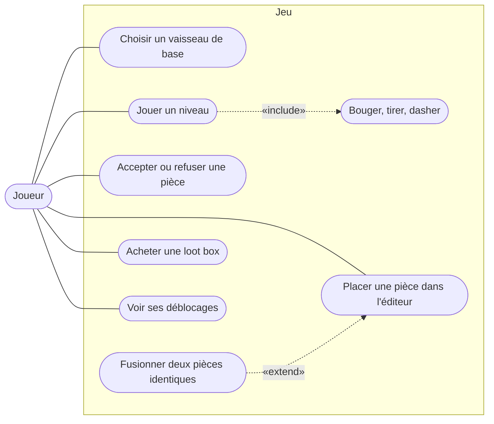

## 2. Paquets

Les flèches indiquent qui dépend de qui. Il n'y a pas de cycle : `entity` ne connaît personne, et `PlayerShip` est rangé dans `ship` pour que `entity` ne dépende pas du vaisseau modulaire.

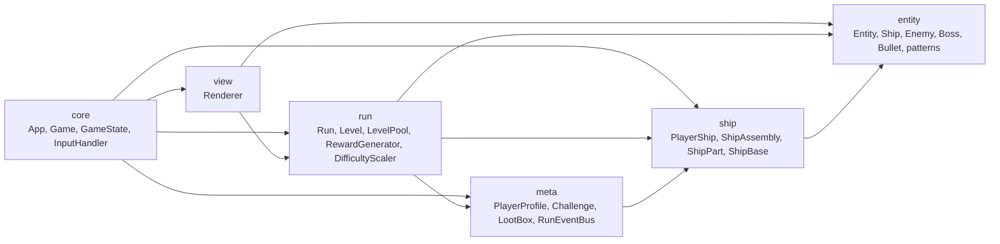

## 3. Diagrammes de classes

### 3.1 Moteur et écrans — State

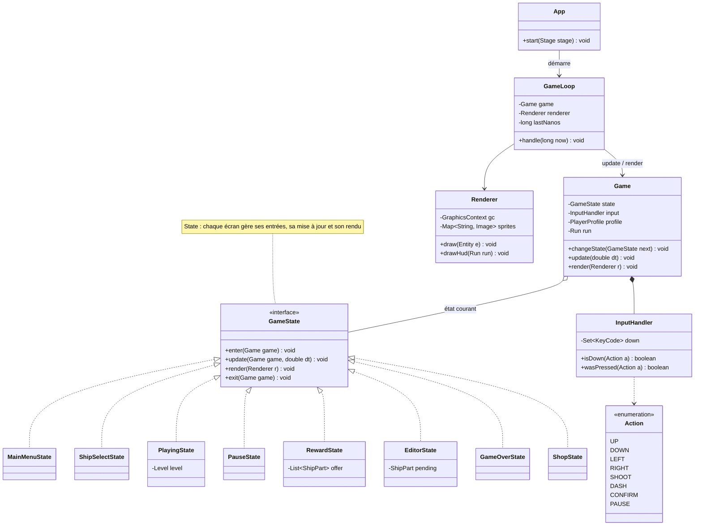

`InputHandler` correspond à la classe `EventHandler` prévue dans le bootstrap. Elle est renommée pour ne pas entrer en conflit avec `javafx.event.EventHandler`.

### 3.2 Entités et collisions

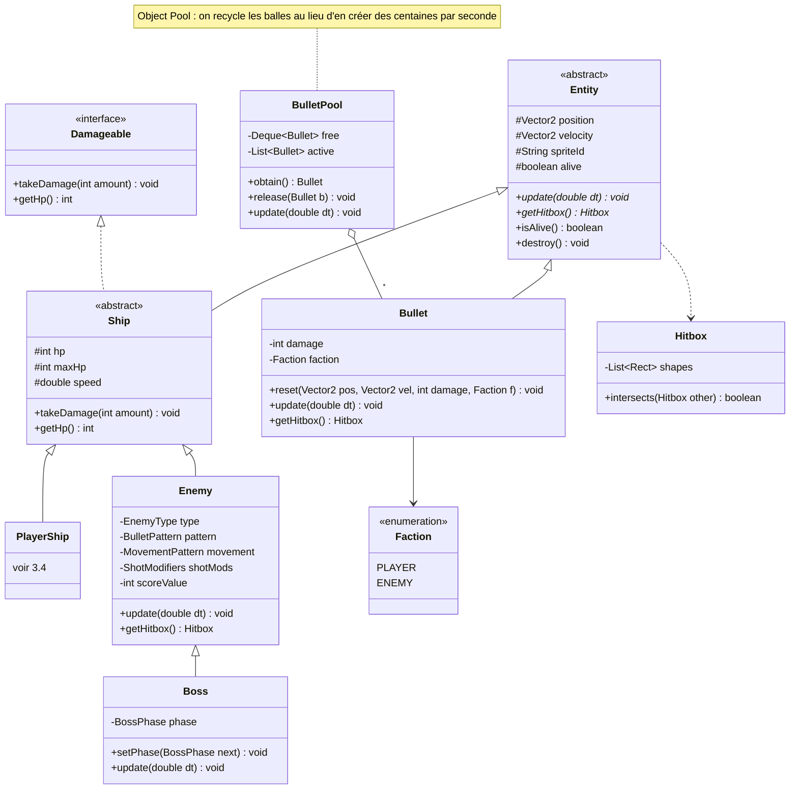

### 3.3 Comportements des ennemis — Strategy, State

Les patterns de tir sont fixes et déterministes (même entrée, mêmes balles), donc apprenables. La difficulté passe par `ShotModifiers` (vitesse et dégâts), pas par de nouvelles attaques.

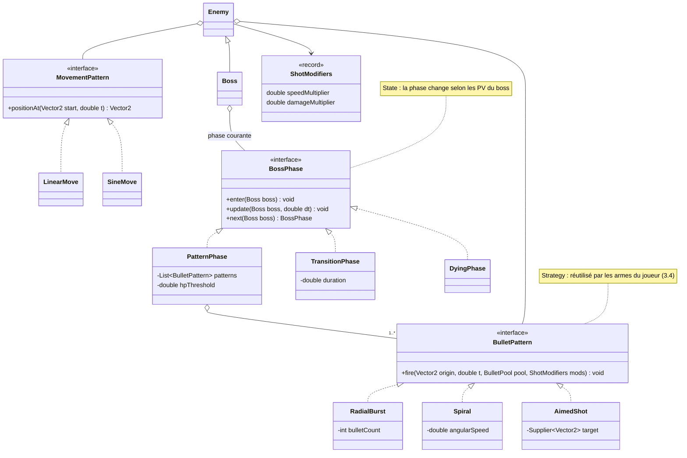

### 3.4 Vaisseau modulaire — Composite, Factory

Chaque pièce occupe une case de la grille. La hitbox du vaisseau est l'union des cases occupées. Fusionner deux pièces identiques additionne leurs stats et libère une case.

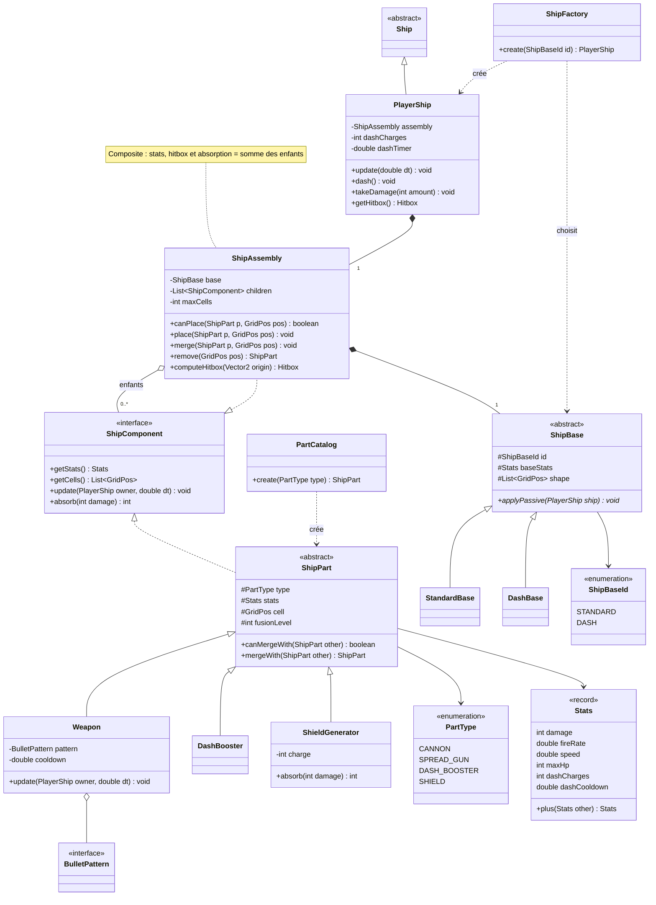

- `CANNON` et `SPREAD_GUN` sont tous deux des `Weapon` : seul leur `BulletPattern` change. Ajouter une arme ne demande pas de nouvelle classe.
- `PlayerShip.takeDamage()` passe d'abord les dégâts à `assembly.absorb()`. Les boucliers en retirent une partie, le reste touche les PV.
- `DashBase` est la base débloquée par le défi des boosters de dash : son `applyPassive()` réduit le temps de recharge du dash.

### 3.5 Run et niveaux

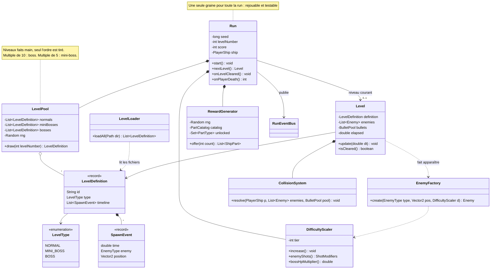

- `Run.nextLevel()` fait `levelNumber++`, `difficulty.increase()`, puis `pool.draw(levelNumber)`. C'est le « Difficulté +1 → niveau tiré au hasard » de la boucle de run.
- `LevelPool.draw()` tire sans remise. Quand le pool de niveaux normaux est vide, il le remélange. La partie peut donc durer à l'infini.
- `LevelPool` et `RewardGenerator` reçoivent un `Random` créé à partir de la graine de la run. Avec la même graine, les tests obtiennent les mêmes niveaux et les mêmes pièces.

### 3.6 Méta-progression — Observer

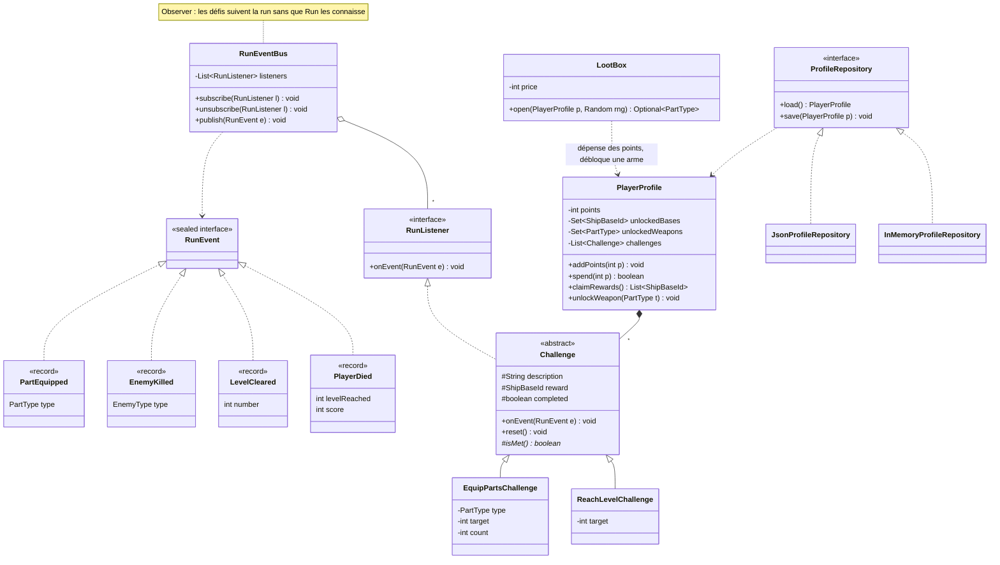

- Au début d'une run, `Run` remet à zéro les défis non remplis du profil et les abonne au bus.
- Exemple : `EquipPartsChallenge(DASH_BOOSTER, 5)` compte les `PartEquipped(DASH_BOOSTER)`. À 5, il passe à `completed` et débloquera `DashBase`.
- `InMemoryProfileRepository` sert aux tests : pas d'écriture sur le disque.

## 4. Diagrammes de séquence

### 4.1 Une frame de jeu

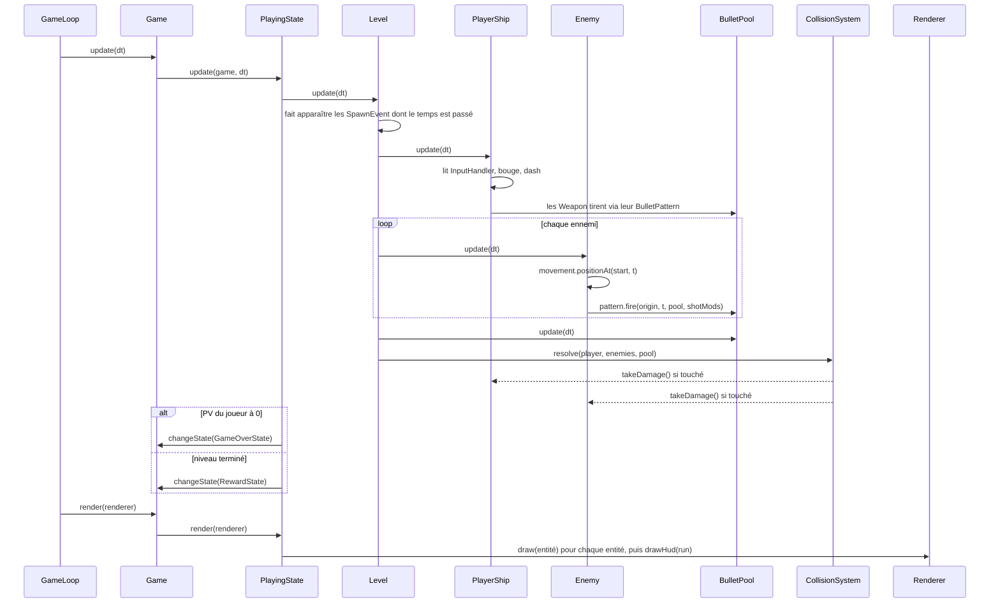

### 4.2 Fin de niveau : récompense, éditeur, fusion

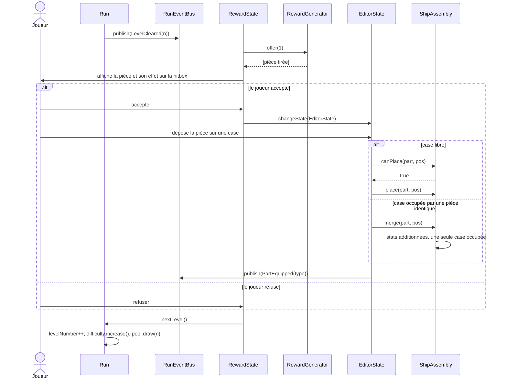

### 4.3 Mort et méta-progression

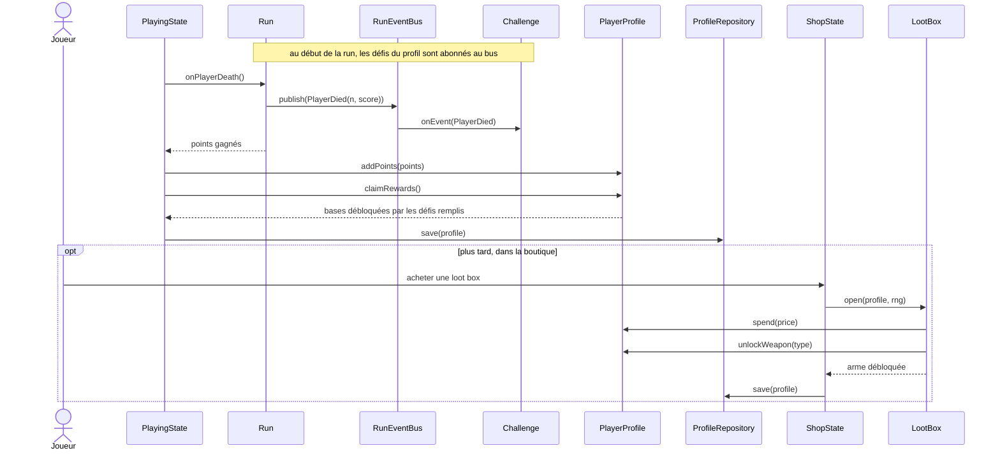

## 5. Diagrammes d'états

### 5.1 États du jeu (`GameState`)

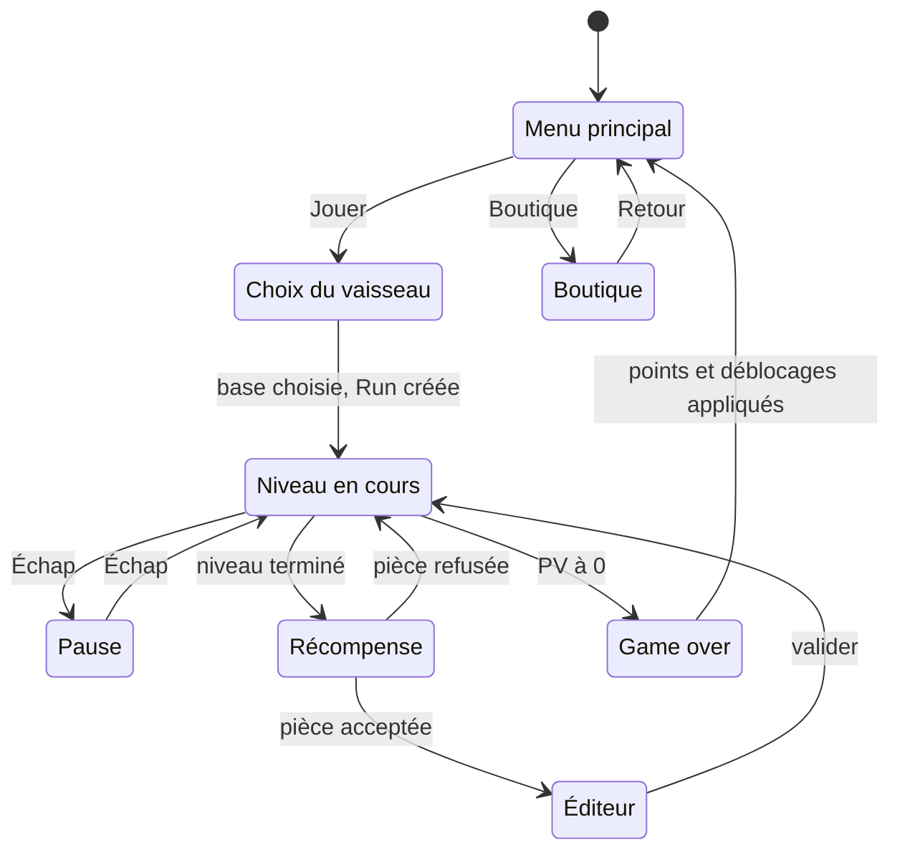

### 5.2 Phases d'un boss (`BossPhase`)

Exemple pour un boss à 3 phases. Un mini-boss en a moins. Les seuils de PV sont des exemples.

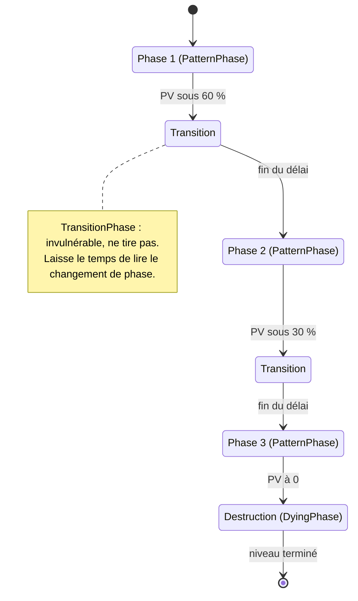

## 6. Patterns retenus

| Pattern     | Où                                             | Pourquoi                                                                                           |
| ----------- | ---------------------------------------------- | -------------------------------------------------------------------------------------------------- |
| State       | `Game` / `GameState`                           | Chaque écran a ses propres entrées, sa mise à jour et son rendu, sans grand `switch` dans la boucle. |
| State       | `Boss` / `BossPhase`                           | Les phases changent selon les PV. Chaque phase est une classe qu'on peut tester seule.              |
| Strategy    | `BulletPattern`, `MovementPattern`             | Les ennemis et les armes du joueur partagent les mêmes patterns. Une nouvelle arme = un nouveau pattern. |
| Composite   | `ShipComponent` / `ShipAssembly` / `ShipPart`  | On traite le vaisseau entier comme une pièce : stats, hitbox et absorption sont la somme des enfants. |
| Factory     | `ShipFactory`, `PartCatalog`, `EnemyFactory`   | Un seul endroit crée les bases, les pièces gagnées et les ennemis ajustés à la difficulté.          |
| Observer    | `RunEventBus` / `RunListener` / `Challenge`    | Les défis suivent la run sans que `Run` les connaisse. On ajoute un défi sans toucher à `Run`.     |
| Object Pool | `BulletPool`                                   | Des centaines de balles à l'écran : on les recycle au lieu d'en créer à chaque tir.                 |
| Repository  | `ProfileRepository`                            | La sauvegarde du profil se remplace par une version en mémoire dans les tests.                     |

## 7. Ce qui dépend des questions ouvertes

Voir les questions ouvertes de [[2D-Game/ideas/pierre/Bullet hell roguelike|l'idée]]. L'UML les laisse ouvertes, avec un choix par défaut.

| Question                                   | Où ça se joue                                  | Choix par défaut                     |
| ------------------------------------------ | ---------------------------------------------- | ------------------------------------ |
| Nombre de pièces proposées                 | `RewardGenerator.offer(int count)`             | 1                                    |
| Limite de fusion                           | `ShipPart.canMergeWith()` vérifie `fusionLevel` | une constante `MAX_FUSION`           |
| Les pièces ont-elles des PV ?              | `ShipPart` implémenterait `Damageable`         | non                                  |
| Taille maximale du vaisseau                | `ShipAssembly.maxCells` et `canPlace()`        | champ prévu, valeur à fixer          |
| Éditeur à chaque niveau ou après un boss ? | transition `Reward → Editor`                   | après chaque pièce acceptée          |
| À quoi servent les points ?                | `PlayerProfile.spend()` est générique          | seulement les loot box               |
