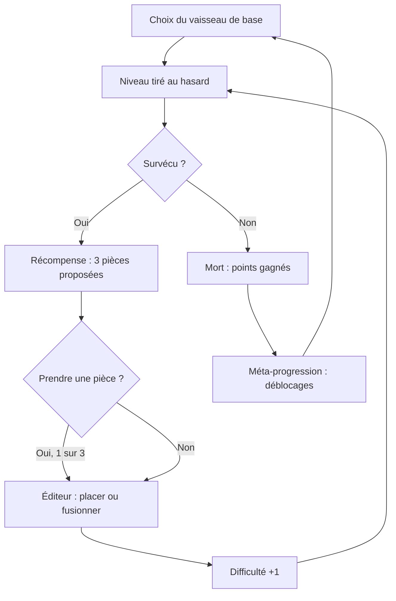
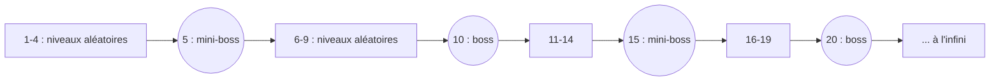
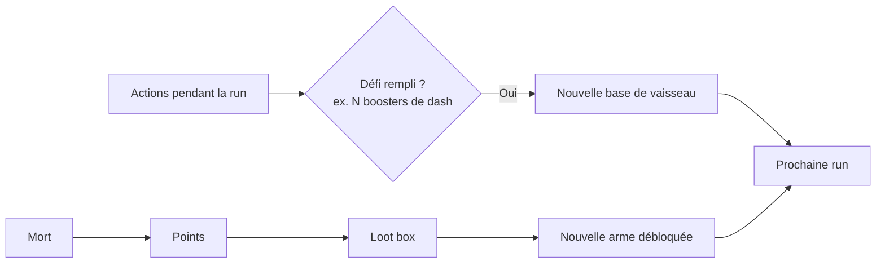

> [!success] Idée retenue
> C'est le jeu choisi pour le projet [[2D-Game/index|2D Game]], développé avec LibGDX.

Idée de [[Pierre]] pour le projet [[2D-Game/index|2D Game]].

UML : [[2D-Game/ideas/pierre/Bullet hell roguelike - UML|Bullet hell roguelike — UML]]

## Pitch

Un **shoot 'em up bullet hell** à la manière d'un **roguelike**. On construit son vaisseau **pièce par pièce** avec les pièces gagnées à la fin de chaque niveau. Les niveaux s'enchaînent **à l'infini**. Chaque pièce ajoutée rend le vaisseau plus fort, **mais aussi plus gros et donc plus facile à toucher**.

## Piliers

1. **Construire, c'est prendre un risque.** Chaque pièce agrandit la hitbox. Il faut choisir entre puissance et esquive.
2. **Les runs sont aléatoires, mais l'apprentissage récompense.** L'ordre des niveaux et les récompenses changent à chaque partie, mais les niveaux et les patterns des boss sont toujours les mêmes, donc on peut les apprendre.
3. **On progresse même en perdant.** La mort débloque de nouveaux vaisseaux et de nouvelles armes.

## Boucle d'une run

## Niveaux

- Les niveaux sont **créés à la main** à l'avance (patterns d'ennemis et de balles fixes).
- **Seul leur ordre est aléatoire.** À chaque run, on en tire un au hasard dans le pool.
- La partie est **infinie**. On joue jusqu'à la mort.
- Un **mini-boss tous les 5 niveaux** et un **boss tous les 10 niveaux**.

## Difficulté

Plus on avance, plus :

- les **balles vont vite** ;
- les balles **font de dégâts** ;
- les **boss ont de PV**.

Les **attaques des boss restent les mêmes** : elles suivent des **patterns fixes**. La difficulté vient de la vitesse, des dégâts et de la résistance, pas de nouvelles attaques.

![[2D-Game/ideas/pierre/assets/difficulte.svg]]

## Récompenses et améliorations

- À la fin de chaque niveau, on se voit proposer **3 pièces aléatoires** et on en **choisit une**.
- On peut **toutes les refuser** si elles nous désavantagent (par exemple une pièce qui grossirait trop la hitbox).

## Éditeur de vaisseau

- L'éditeur est disponible **à la fin de chaque niveau**.
- On place les pièces gagnées sur son vaisseau (canons, boosters de dash…).
- **Chaque pièce prend de la place**, ce qui **agrandit la hitbox**.
- La **taille de la grille dépend du vaisseau de base** : de **3×3 minimum** à **5×5 maximum**.
- On peut **fusionner des pièces identiques**. Leurs **stats s'additionnent** et elles n'occupent **qu'une seule place**. C'est le moyen de devenir plus fort sans trop grossir.
- La fusion a **3 niveaux** : 2 pièces de niveau 1 donnent une pièce de niveau 2, et **3 pièces de niveau 2** donnent une pièce de **niveau 3** (le maximum).

![[2D-Game/ideas/pierre/assets/editeur-fusion.svg]]

## Méta-progression (après la mort)

Il y a deux manières de débloquer du contenu :

| Ce qu'on débloque               | Comment                                               | Exemple                                                                                               |
| ------------------------------- | ----------------------------------------------------- | ----------------------------------------------------------------------------------------------------- |
| **Nouvelles bases de vaisseau** | En remplissant des **défis pendant une run**          | Équiper assez de boosters de dash en une partie débloque un vaisseau qui recharge ses dashs plus vite |
| **Nouvelles armes**             | Avec des **loot box** achetées avec les points gagnés (les points ne servent qu'à ça) | Une loot box donne une arme qui pourra ensuite apparaître dans les récompenses                        |
|                                 |                                                       |                                                                                                       |

## Pourquoi ça colle au projet (POO)

| Élément du jeu                      | Piste de conception                                                               |
| ----------------------------------- | --------------------------------------------------------------------------------- |
| Pièces (canon, booster, bouclier…)  | Classe abstraite `ShipPart` + sous-classes, `merge()` pour la fusion              |
| Vaisseau construit                  | **Composite** : le vaisseau est un assemblage de pièces, avec une hitbox calculée |
| Bases de vaisseau                   | Héritage ou **Factory** `ShipFactory`                                             |
| Patterns de tir des ennemis et boss | **Strategy** `BulletPattern`                                                      |
| Phases des boss                     | **State**                                                                         |
| Ordre des niveaux, récompenses      | `LevelPool` / `RewardGenerator` avec une graine aléatoire (testable)              |
| Défis de déblocage                  | **Observer** sur les événements de la run                                         |
| Montée en difficulté                | `DifficultyScaler` appliqué aux balles et aux PV des boss                         |
|                                     |                                                                                   |

## Questions ouvertes

- [ ] Les pièces ont-elles leurs propres PV (une pièce touchée peut-elle être détruite) ?

### Réponses

- [x] Les **points** obtenus à la mort servent **uniquement à acheter des loot box** (donc des armes).
- [x] **3 pièces** sont proposées à chaque fin de niveau, on en choisit une.
- [x] La fusion va jusqu'au **niveau 3** : 2 pièces de niveau 1 → niveau 2, 3 pièces de niveau 2 → niveau 3.
- [x] La taille du vaisseau dépend de la base : de **3×3** à **5×5**.
- [x] L'éditeur est disponible **à chaque fin de niveau**.
- [x] Il faut créer **au moins 20 niveaux** pour que l'ordre aléatoire reste varié.
