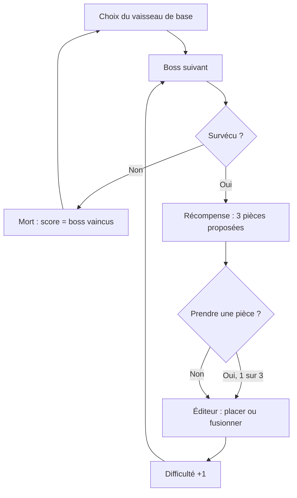
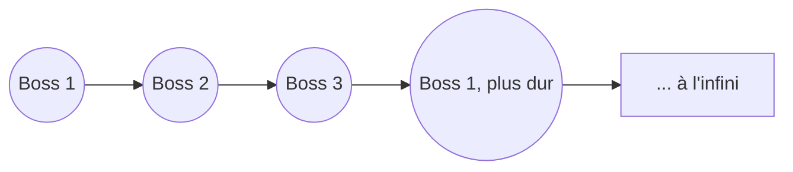

> [!success] Idée retenue
> C'est le jeu choisi pour le projet [[2D-Game/index|2D Game]], développé avec LibGDX.

Idée de [[Pierre]] pour le projet [[2D-Game/index|2D Game]].

UML : [[2D-Game/ideas/pierre/Bullet hell roguelike - UML|Bullet hell roguelike — UML]]

> [!note] Périmètre réduit le 2026-11-24 : boss rush
> Pour finir dans les temps, le jeu est un **enchaînement de boss**. Les niveaux normaux, les mini-boss et la méta-progression sont mis de côté dans [[2D-Game/ideas/pierre/Bullet hell roguelike - UML (mis de côté)|UML (mis de côté)]].

## Pitch

Un **shoot 'em up bullet hell** en **boss rush**, à la manière d'un **roguelike**. On affronte les boss **les uns après les autres**, et on construit son vaisseau **pièce par pièce** avec les pièces gagnées après chaque boss. Les boss s'enchaînent **à l'infini**, de plus en plus durs. Chaque pièce ajoutée rend le vaisseau plus fort, **mais aussi plus gros et donc plus facile à toucher**.

## Piliers

1. **Construire, c'est prendre un risque.** Chaque pièce agrandit la hitbox. Il faut choisir entre puissance et esquive.
2. **Les récompenses sont aléatoires, mais l'apprentissage récompense.** Les pièces proposées changent à chaque partie, mais les boss et leurs patterns sont toujours les mêmes, donc on peut les apprendre.

## Boucle d'une run

## Boss rush

- Le jeu n'a **que des boss** : pas de niveaux normaux ni de mini-boss.
- Les boss sont **faits à la main** (patterns fixes) et arrivent **toujours dans le même ordre** (au moins 3).
- Après le dernier boss, on **repart du premier, plus difficile**. La partie est **infinie** : on joue jusqu'à la mort.
- Le **score** est le nombre de boss vaincus.

## Difficulté

Plus on avance, plus :

- les **balles vont vite** ;
- les balles **font de dégâts** ;
- les **boss ont de PV**.

Les **attaques des boss restent les mêmes** : elles suivent des **patterns fixes**. La difficulté vient de la vitesse, des dégâts et de la résistance, pas de nouvelles attaques.

![[2D-Game/ideas/pierre/assets/difficulte.svg]]

## Récompenses et améliorations

- Après chaque boss vaincu, on se voit proposer **3 pièces aléatoires** et on en **choisit une**.
- On peut **toutes les refuser** si elles nous désavantagent (par exemple une pièce qui grossirait trop la hitbox).

## Éditeur de vaisseau

- L'éditeur est disponible **après chaque boss**.
- On place les pièces gagnées sur son vaisseau (canons, boosters de dash…).
- Deux bases de vaisseau sont disponibles dès le début : la **standard** et la **base dash**.
- **Chaque pièce prend de la place**, ce qui **agrandit la hitbox**.
- La **taille de la grille dépend du vaisseau de base** : de **3×3 minimum** à **5×5 maximum**.
- On peut **fusionner des pièces identiques**. Leurs **stats s'additionnent** et elles n'occupent **qu'une seule place**. C'est le moyen de devenir plus fort sans trop grossir.
- La fusion a **3 niveaux** : 2 pièces de niveau 1 donnent une pièce de niveau 2, et **2 pièces de niveau 2** donnent une pièce de **niveau 3** (le maximum).

![[2D-Game/ideas/pierre/assets/editeur-fusion.svg]]

## Pourquoi ça colle au projet (POO)

| Élément du jeu                      | Piste de conception                                                               |
| ----------------------------------- | --------------------------------------------------------------------------------- |
| Pièces (canon, booster, bouclier…)  | Classe abstraite `ShipPart` + sous-classes, `merge()` pour la fusion              |
| Vaisseau construit                  | **Composite** : le vaisseau est un assemblage de pièces, avec une hitbox calculée |
| Bases de vaisseau                   | Héritage ou **Factory** `ShipFactory`                                             |
| Patterns de tir des ennemis et boss | **Strategy** `BulletPattern`                                                      |
| Phases des boss                     | **State**                                                                         |
| Enchaînement des boss, récompenses  | `BossFactory` / `RewardGenerator` avec une graine aléatoire (testable)            |
| Montée en difficulté                | `DifficultyScaler` appliqué aux balles et aux PV des boss                         |
|                                     |                                                                                   |

## Questions ouvertes

- [ ] Les pièces ont-elles leurs propres PV (une pièce touchée peut-elle être détruite) ?

### Réponses

- [x] Le jeu est un **boss rush** (décidé le 2026-11-24) : niveaux normaux, mini-boss et méta-progression mis de côté.
- [x] **3 pièces** sont proposées après chaque boss, on en choisit une.
- [x] La fusion va jusqu'au **niveau 3** : 2 pièces de niveau 1 → niveau 2, 2 pièces de niveau 2 → niveau 3.
- [x] La taille du vaisseau dépend de la base : de **3×3** à **5×5**.
- [x] L'éditeur est disponible **après chaque boss**.
- [x] Les boss arrivent dans un **ordre fixe, en boucle**, et la difficulté monte à chaque boss.
