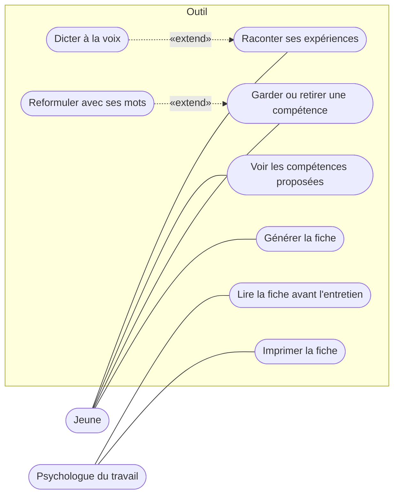
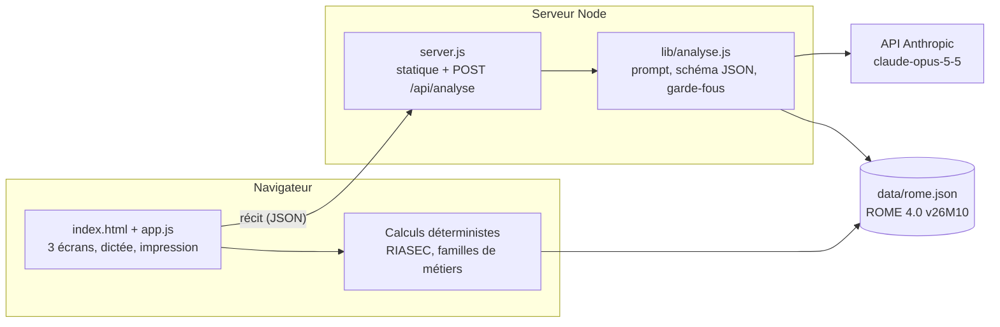
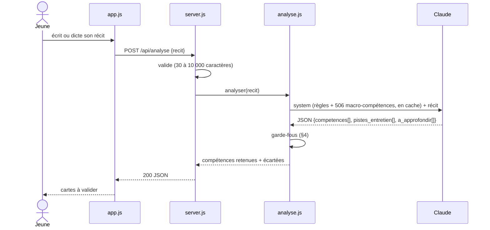
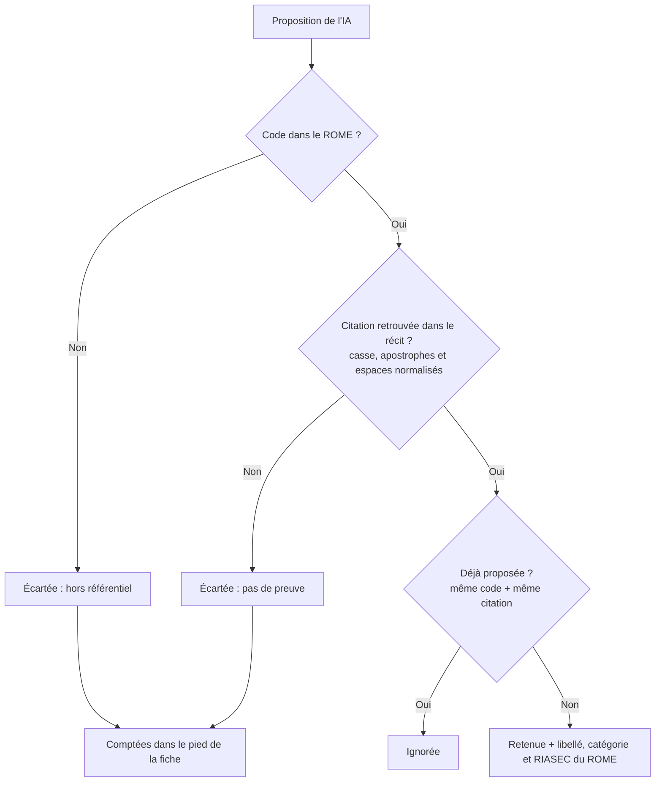
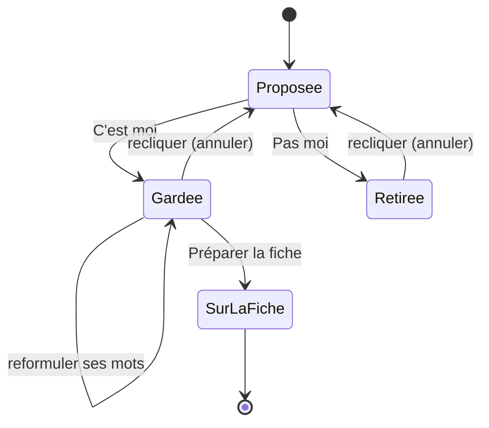
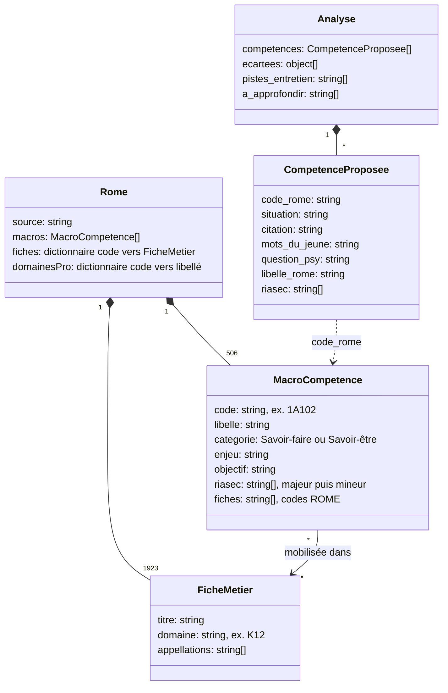

UML de l'idée [[Hackathon-IA/ideas/pierre/Fiche de préparation psy|Potentiel caché — fiche de préparation pour le psy]]. Ça couvre la partie UML de [[02 - Conception (parcours & UML)]].

Cible : Node.js ≥ 20, sans framework, ES modules. Front en HTML/CSS/JS vanilla. Modèle `claude-opus-5-5` via `@anthropic-ai/sdk`.

**Choix de départ : l'IA ne fait qu'une seule chose, proposer des compétences prouvées.** Tout le reste est du code déterministe sur les données du ROME : la vérification des preuves, le RIASEC et les familles de métiers. C'est ce qui rend le résultat explicable au jury.

## 1. Cas d'utilisation

## 2. Composants

En démo statique (GitHub Pages, sans serveur), `app.js` charge les résultats pré-calculés `demo/<exemple>.json`, produits par `npm run demo`.

## 3. Séquence — analyse d'un récit

## 4. Activité — garde-fous sur chaque proposition

Les règles côté prompt (aucune déduction sensible, tutoiement, pas de score…) sont dans `SYSTEM`, dans `lib/analyse.js`.

## 5. États — une carte de compétence

Le bouton « Préparer la fiche » est désactivé tant qu'aucune carte n'est gardée.

## 6. Modèle de données

## 7. Familles de métiers — algorithme

1. Pour chaque compétence gardée, on prend les fiches ROME qui la mobilisent.
2. On compte, pour chaque fiche, combien de compétences gardées y mènent.
3. On regroupe par domaine professionnel (ex. `K12`) et on additionne.
4. On garde les **4 domaines** qui reviennent le plus, et dans chacun les **3 fiches** les plus partagées, avec un lien Métierscope.

C'est présenté comme « à explorer ensemble, pas une recommandation ».
