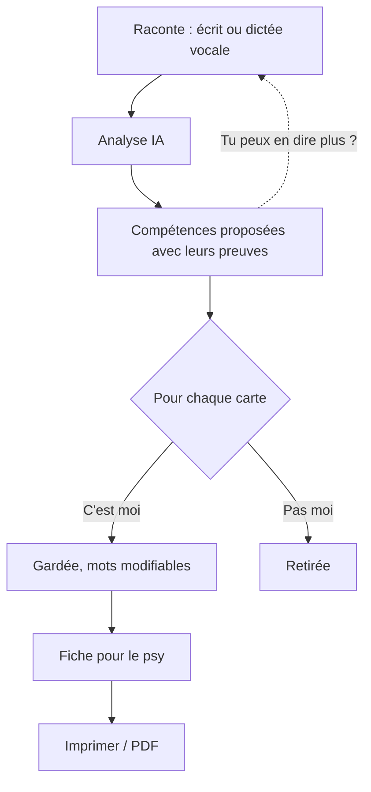

> [!success] Idée retenue
> C'est le projet de l'équipe 12 pour le [[Hackathon-IA/index|Hackathon IA]] (sujet 4).

Idée de [[Pierre]] pour le [[Hackathon-IA/index|Hackathon IA]].

UML : [[Hackathon-IA/ideas/pierre/Fiche de préparation psy - UML|Fiche de préparation psy — UML]]

## Pitch

Un jeune qui « ne sait rien faire » **raconte ce qu'il vit** : il garde ses frères, répare des scooters, modère un Discord. L'IA y repère des **compétences du référentiel ROME 4.0**, **chacune prouvée par une citation exacte** de son récit. **Le jeune garde, retire ou reformule** chaque compétence. Il en sort une **fiche pour l'entretien de 15 minutes avec le psychologue du travail**.

## Piliers

1. **Pas de preuve, pas de compétence.** Chaque compétence est justifiée par les mots du jeune, et le serveur vérifie que la citation figure bien dans le récit.
2. **Le jeune décide.** Rien n'arrive sur la fiche sans son « C'est moi ».
3. **L'IA éclaire, le psy décide.** Pas de score, pas de niveau, pas de verdict d'orientation.

## Parcours

## Écran 1 — Raconte

- Un champ libre, avec la consigne « écris comme tu parles ».
- Des **relances** pour démarrer : « Un truc que tu as réparé ? », « Ce que tu fais en ligne ? »…
- **Dictée vocale** (Web Speech API, Chrome) pour ceux qui n'aiment pas écrire.
- 3 récits d'exemple **inventés** : Inès (garde d'enfants, démarches administratives, caisse), Yanis (scooters, revente en ligne), Lou (modération Discord, tournois).

## Écran 2 — Choisis

Une carte par compétence proposée :

| Élément | Exemple |
|---|---|
| Situation | GARDE DES PETITS FRÈRES |
| Repère RIASEC | Aider, accompagner, transmettre |
| Ses mots, modifiables | « Tu sais gérer deux enfants et leur faire respecter des règles. » |
| Preuve | « je vérifie qu'ils font leurs devoirs avant de jouer » |
| ROME | 1A102 · Assurer l'encadrement de l'enfant ou d'un groupe d'enfants |

Plus un bloc « **Tu peux en dire plus ?** » pour les situations évoquées trop vite.

## Écran 3 — Fiche pour le psy

1. Un tableau avec la situation, la compétence ROME, la preuve (ses mots) et une question pour en parler.
2. **Les repères d'intérêts (RIASEC)** : 6 tuiles R-I-A-S-E-C avec les situations qui s'y rattachent. Les 2 types qui reviennent le plus sont mis en avant, avec une question pour vérifier. Voir [[Hackathon-IA/ideas/pierre/Tests psychométriques|Tests psychométriques]].
3. 2 ou 3 **pistes pour ouvrir l'entretien**.
4. **Les familles de métiers** qui mobilisent ces compétences, calculées sur le ROME, avec des liens vers Métierscope.

## Garde-fous

- Aucune déduction sur la santé, l'origine, la famille ou la religion. Cas test : « Ma mère parle pas bien français alors c'est moi qui l'accompagne… ». On retient la compétence (traduire, faire le lien, accompagner des démarches), jamais l'information sur la famille ou l'origine.
- Les propositions écartées (code inconnu, citation introuvable) sont comptées et affichées en bas de la fiche.
- Aucun récit n'est enregistré, et la clé API reste côté serveur.

## Stack

Node.js (serveur sans framework) · HTML/CSS/JS vanilla · Claude Opus 5.5 (sortie JSON structurée) · ROME 4.0 v26M10 (open data France Travail).
