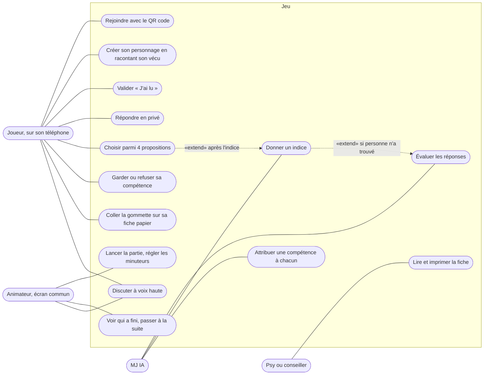
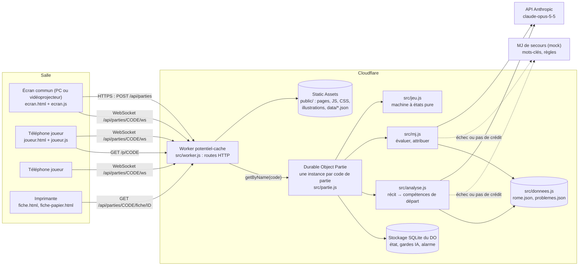
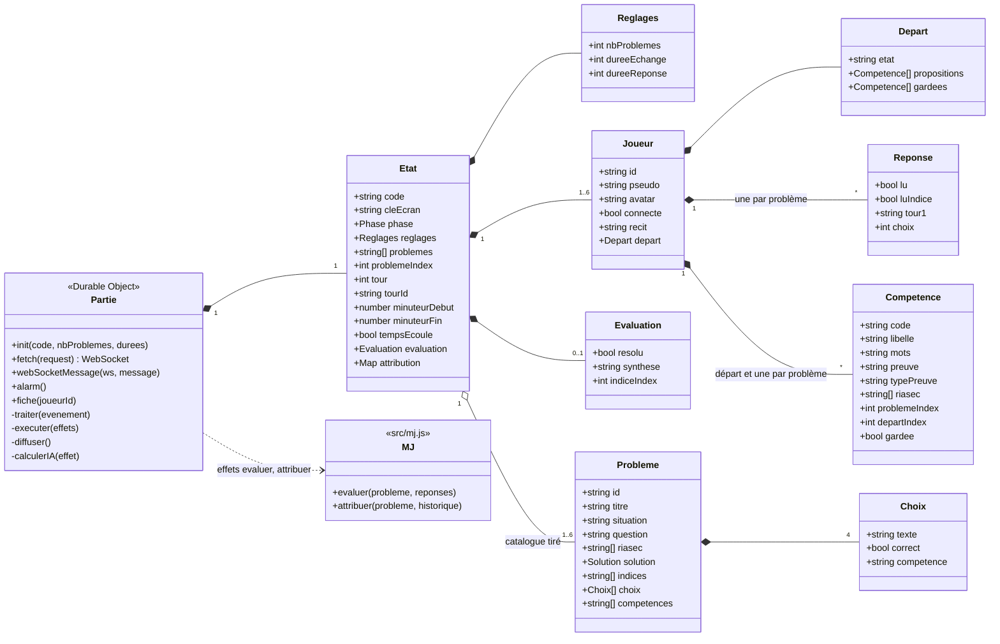
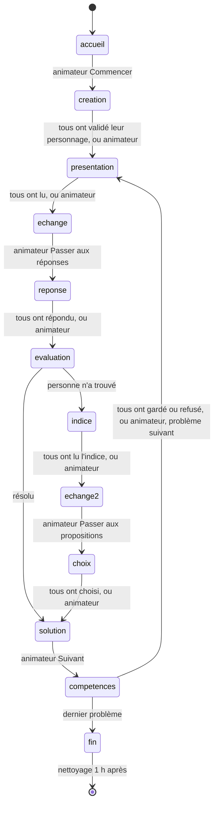
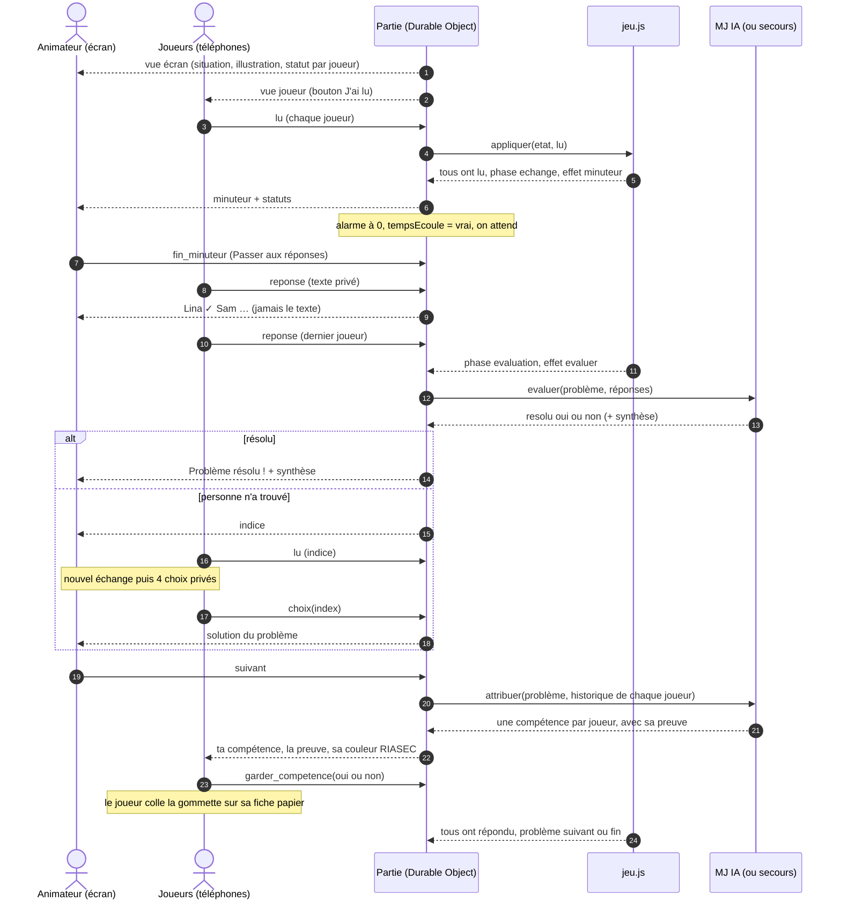
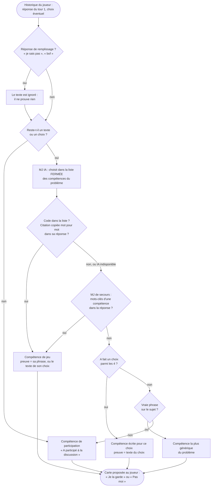
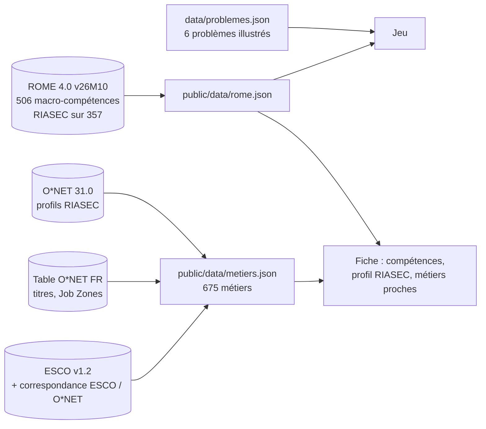

UML du [[Hackathon-IA/ideas/pierre/Jeu de rôle des compétences|jeu de rôle des compétences]], tel qu'il est codé dans le dépôt `2026-equipe-12` (commit `b5f316c`, 19/11/2026). Le choix du format et du matériel est dans [[Hackathon-IA/ideas/pierre/Jeu de rôle - mise en place|la mise en place]]. Le contrat technique détaillé est `SPEC.md`.

Cible : **Cloudflare Workers + Durable Objects** (JavaScript, ES modules), front en HTML/CSS/JS vanilla, MJ IA `claude-opus-5-5` via `@anthropic-ai/sdk`, avec un **MJ de secours** déterministe (mock) quand l'IA ne répond pas. En prod sur https://potentiel-cache.planbhunalp.workers.dev.

**Choix de départ : la logique du jeu est une machine à états PURE** (`src/jeu.js`, sans réseau, sans horloge, sans aléatoire). Le Durable Object ne fait qu'orchestrer : il applique un événement, persiste l'état, exécute les effets (minuteur, appels IA) et envoie à chacun **sa** vue filtrée. Ça rend tout le jeu testable sans serveur, et la confidentialité vérifiable : une réponse n'existe que dans la vue de son auteur.

## 1. Cas d'utilisation

## 2. Déploiement et composants

| Route | Rôle |
|---|---|
| `POST /api/parties` | crée une partie, renvoie `{ code, cleEcran }` (la clé animateur ne sort jamais ailleurs) |
| `GET /api/parties/CODE/ws?role=ecran&cle=…` | WebSocket de l'écran animateur (refus 4003 sans la bonne clé) |
| `GET /api/parties/CODE/ws?role=joueur&joueur=ID` | WebSocket d'un joueur (reconnexion avec le même ID) |
| `GET /api/parties/CODE/fiche/ID` | fiche JSON d'un joueur (compétences gardées, RIASEC) |
| `GET /p/CODE` | lien du QR code → page joueur |
| `POST /api/analyse` | outil solo (fiche sans jeu) |

## 3. Classes — état d'une partie

`typePreuve` vaut `vecu` (compétence de départ, tirée du récit), `jeu` (montrée pendant le jeu) ou `participation` (filet de sécurité : personne ne repart sans compétence). `gardee` vaut `null` tant que le joueur n'a pas répondu, ce qui permet de lui reproposer la carte plus tard.

## 4. États — les phases d'une partie

Règles portées par ces transitions :

- **À la fin d'un minuteur, rien n'avance tout seul.** L'alarme met seulement `tempsEcoule` à vrai. L'écran affiche « Temps écoulé » et les joueurs en retard peuvent encore répondre.
- **On s'arrête dès qu'une personne a bien répondu** : l'évaluation porte sur toutes les réponses du tour, et un seul « résolu » suffit.
- **Personne n'apprend qu'il s'est trompé** : aucune vue ne dit qui a trouvé ni quelle proposition était la bonne.
- **Une compétence par joueur et par problème**, donnée en phase `competences`, y compris à ceux qui n'ont pas trouvé.
- Si le MJ IA ne répond pas (`evaluation`, `competences`), le bouton « Suivant » de l'animateur relance l'étape avec le MJ de secours.

## 5. Séquence — un tour de jeu

## 6. Activité — attribuer une compétence à un joueur

Les garde-fous viennent de la [[Hackathon-IA/ideas/pierre/Fiche de préparation psy - UML|fiche de préparation psy]] : liste ROME fermée, citation vérifiée, et l'humain qui décide en dernier.

## 7. Qui voit quoi

| Donnée | Auteur | Autres joueurs | Écran commun | Fiche |
|---|---|---|---|---|
| Récit de départ | ✅ | ❌ | ❌ | preuve « vécu » si gardée |
| Texte d'une réponse | ✅ | ❌ | ❌ | preuve « montrée en jeu » si gardée |
| Choix parmi les 4 | ✅ | ❌ | ❌ | ❌ |
| A lu, a répondu, a choisi | ✅ | ❌ | ✅ (✓ ou …) | ❌ |
| Qui a trouvé la solution | ❌ | ❌ | ❌ | ❌ |
| Compétence reçue | ✅ | ❌ | ❌ | ✅ si gardée |

Le serveur construit une vue par rôle (`vue(etat, role, joueurId)`). Les tests et la simulation vérifient qu'aucun texte de réponse ni de récit n'arrive jamais à l'écran ou chez un autre joueur.

## 8. Données

Les métiers proches se calculent par **cosinus** entre le profil RIASEC des compétences gardées et celui de chaque métier, sur des vecteurs centrés (lettre majeure = 2, mineure = 1).
