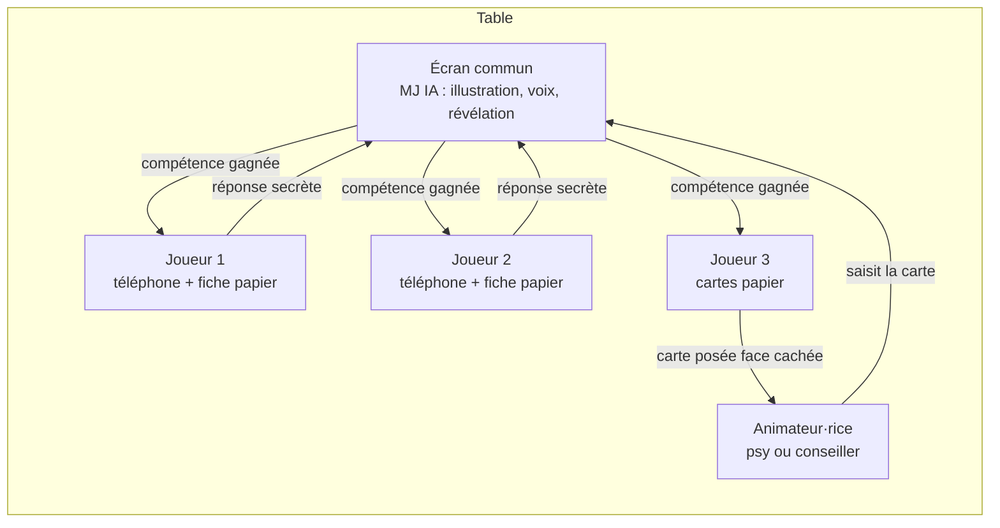

Comment mettre en place, physiquement et techniquement, le [[Hackathon-IA/ideas/pierre/Jeu de rôle des compétences|jeu de rôle des compétences]].

> [!success] Décisions (18/11/2026)
> - **Format B retenu** : écran commun pour le MJ IA, réponses sur téléphone via QR code, fiche personnage papier avec gommettes.
> - **Pas de cartes pour l'instant** (ni cartes-actions ni cartes problèmes) : chaque joueur répond sur son téléphone, à la voix ou à l'écrit.
> - **Téléphones, réseau, imprimante et gommettes** : c'est bon.
> - **Hébergement Railway et clé API** : on y réfléchit plus tard.

> [!tip] Propositions
> Pour chaque point, la recommandation est marquée ⭐. Les parties « cartes » restent dans la note pour plus tard.

## 1. Trois formats possibles

| Format | Comment ça marche | + | − |
|---|---|---|---|
| **A. Tout sur une tablette** | Une tablette qu'on se passe ; elle affiche le MJ, les réponses, la fiche | Le plus simple à coder | Les réponses ne sont pas simultanées ; on attend son tour ; peu « jeu de rôle » |
| **B. Hybride écran + téléphones + papier** ⭐ | Un **écran commun** (PC ou projecteur) pour le MJ. **Chaque joueur répond sur son téléphone** via un QR code, sans rien installer. **Une fiche personnage papier** avec des **gommettes** pour les compétences gagnées | Réponses secrètes et simultanées (bien pour les timides) ; une récompense physique qu'on garde ; une vraie ambiance de table | Il faut synchroniser les téléphones (½ jour de dev en plus) ; il faut imprimer |
| **C. Jeu de plateau, IA en coulisse** | Tout est sur papier et en cartes ; l'animateur saisit les réponses pour l'IA | Fonctionne même sans téléphone | L'animateur devient un goulot ; l'IA est peu visible pour le jury |

**Solution de secours du format B :** si un joueur n'a pas de téléphone, il répond avec les **cartes-actions papier**, et l'animateur clique son choix sur l'écran.

## 2. Une séance type (format B)

1. **Accueil (5 min).** Chacun reçoit sa fiche personnage, choisit un **pseudo** et un avatar, et scanne le QR code de la partie.
2. **Création du personnage (5 min).** Chacun écrit ou dicte sur son téléphone 1 ou 2 choses qu'il a déjà faites. Ce sont ses compétences de départ, et il les recopie ou les colle sur sa fiche.
3. **Problème 1, puis 2, puis 3 (environ 5 min chacun).**
   - L'écran montre l'illustration et le MJ lit la situation à voix haute.
   - Tout le monde répond **en même temps et en secret** : voix, texte ou carte. Une barre « 3/4 ont répondu » s'affiche, sans les noms.
   - Le MJ **révèle toutes les réponses d'un coup**, sans les noms, et assemble la solution commune, ou donne un indice.
   - Chaque joueur reçoit sur son téléphone **sa** compétence et **sa** phrase-preuve, puis « C'est moi / Pas moi ». S'il la garde, il **colle la gommette** de la couleur RIASEC sur sa fiche.
   - Question bonus facultative sur le téléphone : « Ça t'est déjà arrivé en vrai ? »
4. **Fin (5 min).** Chacun repart avec sa **fiche papier remplie**. L'animateur imprime ou envoie la **fiche pour le psy** de chaque joueur (l'outil actuel), avec deux types de preuves : vécue et montrée en jeu.

## 3. Matériel physique

| Objet | Contenu | Format |
|---|---|---|
| **Fiche personnage** ⭐ | Recto : pseudo, avatar à dessiner, « Ce que je sais déjà faire » (vécu), 6 zones R-I-A-S-E-C en couleur. Verso : « Compétences gagnées » avec les cases où coller les gommettes et la phrase-preuve | A4, 1 par joueur |
| **Gommettes / stickers compétences** ⭐ | Une couleur par type RIASEC, avec le picto et un espace pour écrire la compétence | Planches d'étiquettes rondes (type Avery) ou gommettes de couleur |
| **Cartes-actions** | 8 à 12 actions génériques illustrées : « Je demande de l'aide », « Je cherche un tuto », « J'essaie moi-même », « Je m'organise », « Je calme la situation »… avec un numéro ou un QR code | Cartes A7, 1 jeu par joueur |
| **Cartes problèmes** (secours) | Illustration + situation, au cas où l'écran tombe en panne | A5 |
| **Règles en une page** | Le but, le tour de jeu, « il n'y a pas de mauvaise réponse », le joker | A4 recto |
| **Livret animateur** | Déroulé minuté, phrases de bienveillance, que faire si un jeune bloque ou s'il évoque un sujet sensible, comment lire la fiche psy | 4 pages A5 |
| **QR code de la partie** | Affiché sur l'écran, et imprimé en secours | — |

Tout est **généré depuis l'application** en HTML avec une mise en page pour l'impression. On imprime ou on enregistre en PDF, sans logiciel de mise en page.

## 4. Stack technique

| Brique | Proposition | Alternatives |
|---|---|---|
| **Front** | ⭐ HTML/CSS/JS vanilla, dans la continuité de l'existant | React ou Svelte : plus confortable, mais il faut tout refaire |
| **Synchronisation écran ↔ téléphones** | ⭐ **Server-Sent Events** (natif dans Node et les navigateurs, sans librairie) + POST pour les réponses | Polling toutes les 2 s (le plus simple) ; WebSocket / Socket.IO (bidirectionnel, une dépendance en plus) |
| **État de la partie** | ⭐ En mémoire dans le serveur, avec un code de partie à 4 lettres, effacé à la fin | Une base de données : inutile, et on ne veut rien garder |
| **MJ (IA)** | ⭐ Claude Opus 5.5, avec une réponse JSON vérifiée côté serveur (liste ROME fermée par problème + citations vérifiées) | — |
| **Voix du MJ** | ⭐ Web Speech **synthèse vocale** (gratuit, dans le navigateur) : aide ceux qui lisent difficilement | TTS en ligne : plus naturel, mais payant et demande une clé |
| **Dictée des joueurs** | ⭐ Web Speech **reconnaissance vocale** (déjà en place, Chrome / Android) | Whisper ou un autre service : marche aussi sur iPhone, mais demande une clé |
| **QR code** | Librairie `qrcode` côté navigateur (CDN) | — |
| **Illustrations** | ⭐ Banques libres de droits (unDraw, Open Peeps…) + pictos RIASEC | Générées par IA une fois puis relues ; dessinées par l'équipe |
| **Hébergement** | ⭐ **Railway** (serveur Node, la clé API reste côté serveur), en HTTPS pour que le micro et le QR code marchent sur téléphone | Render, Fly.io. GitHub Pages ne peut pas : pas de serveur |
| **Impression** | ⭐ Pages HTML + CSS `@media print` | Génération PDF côté serveur : inutile |

> [!warning] HTTPS obligatoire
> La dictée vocale et l'accès depuis les téléphones demandent une URL en **https**. En local, les téléphones ne peuvent pas joindre `localhost` : pour les tests sur le réseau du hackathon, il faut un hébergement (Railway) ou un tunnel.

## 5. Documents à produire

**Pour le jeu :**
- [ ] `data/problemes.json` : 3 problèmes minimum pour la démo, puis 6 à 10 (situation, illustration, cartes-actions, compétences ROME autorisées, 2 indices, question bonus)
- [ ] Règles en une page
- [ ] Fiche personnage (gabarit imprimable)
- [ ] Planche de gommettes compétences (gabarit imprimable)
- [ ] Cartes-actions (gabarit imprimable)
- [ ] Livret animateur

**Pour le hackathon :**
- [ ] Note technique + UML du jeu (séquence d'un tour, états de la partie, modèle de données)
- [ ] README et `projet.json` mis à jour
- [ ] Captures d'écran (écran commun, téléphone, fiche papier remplie)
- [ ] Vidéo d'une partie (secours si la démo plante)
- [ ] Support du pitch : 5 min, avec une **partie jouée en live avec le jury** si possible (2 membres du jury jouent sur leur téléphone)

## 6. Questions en suspens

- [x] **Format :** B, sans les cartes pour l'instant
- [x] **Les téléphones et le réseau** : c'est bon
- [x] **Une imprimante et des gommettes** : c'est bon
- [ ] **Cartes-actions papier** : à reprendre plus tard (solution de secours sans téléphone, aide pour les timides)
- [ ] **Qui anime** : le psy, un conseiller, ou personne (l'IA seule) ?
- [ ] **Hébergement** : Railway (compte de qui, clé API de qui ?) → **plus tard**
- [ ] **Démo devant le jury** : on fait jouer le jury en vrai, ou on montre une partie enregistrée ?
