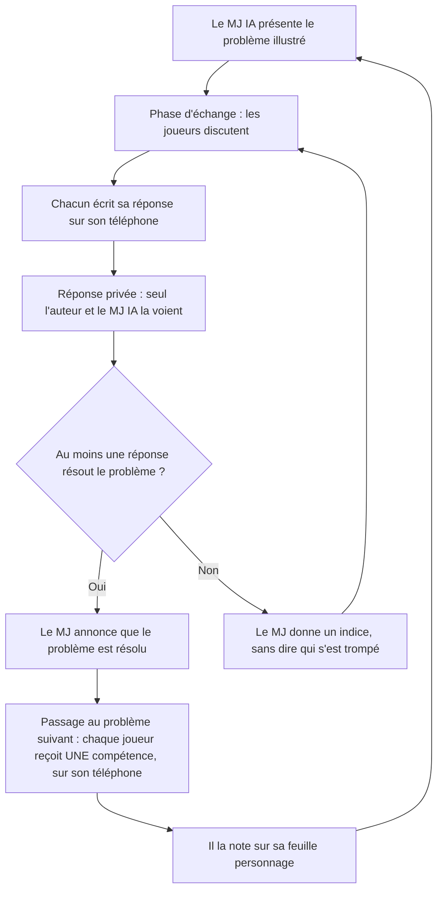
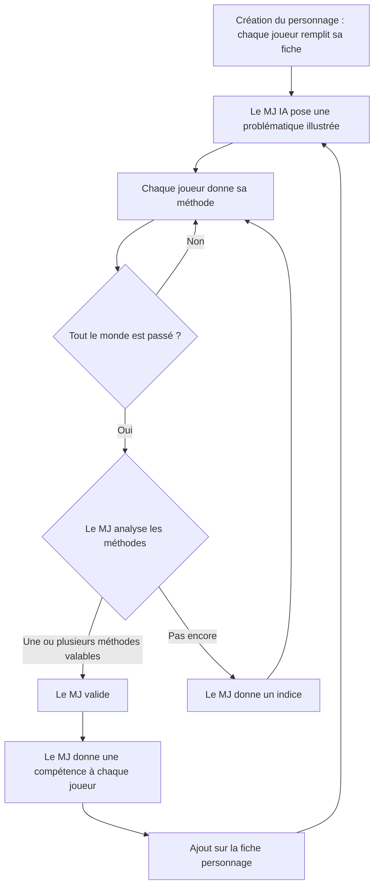

> [!success] Idée validée (18/11/2026)
> Mise en place : [[Hackathon-IA/ideas/pierre/Jeu de rôle - mise en place|formats, matériel, stack, documents]]. Les **règles validées** ci-dessous remplacent les propositions des sections suivantes quand elles se contredisent.

## Règles validées par Pierre (18/11/2026)

1. **Phase d'échange d'abord.** Le MJ présente le problème, puis les joueurs **discutent entre eux** avant de proposer quoi que ce soit.
2. **Réponses privées.** Après l'échange, chacun écrit sa réponse sur son téléphone. **Seul celui qui l'a écrite la connaît** : elle n'est montrée ni aux autres joueurs, ni sur l'écran commun. Seul le MJ IA la lit.
3. **Pas de joker.** Tout le monde répond.
4. **On s'arrête dès qu'une personne a bien répondu**, même si les autres se sont trompés ou ont mal répondu.
5. **Tout le monde gagne une compétence, une seule par problème**, donnée **quand on passe au problème suivant**. Ceux qui n'ont pas trouvé en gagnent une aussi. **L'IA doit trouver dans chaque réponse une compétence à mettre en avant**, et le joueur la met sur sa feuille.
6. **Personne n'est notifié d'avoir mal répondu.** On ne voit jamais « faux », ni pour soi ni pour les autres.

**Ce que ça implique côté IA (MJ) :**
- Pour chaque réponse, même fausse ou incomplète, le MJ cherche **ce qu'elle montre de positif** : sécuriser, demander de l'aide, s'organiser, proposer une idée, écouter les autres… Cette compétence est prise dans la liste ROME du problème.
- La **preuve reste la phrase du joueur** : la compétence est justifiée par ce qu'il a écrit, pas inventée.
- Le MJ ne dit jamais qu'une réponse est **fausse**. Il dit « problème résolu » sans désigner la personne ni les réponses à côté.

**Questions qui en découlent :**
- [ ] Si **personne** n'a trouvé : indice puis nouveau tour d'échange (c'est ce que montre le schéma), ou le MJ donne la solution ? _(à confirmer)_
- [x] Au 2ᵉ tour, une 2ᵉ compétence ? → **Non : une seule par problème**, donnée quand on passe au problème suivant. Si un joueur a répondu à plusieurs tours, le MJ choisit la compétence parmi toutes ses réponses à ce problème.
- [ ] Si une réponse est vide ou hors sujet (« jsp », « lol »), quelle compétence ? Proposition : « participer à un travail d'équipe », tirée de la phase d'échange. _(à confirmer)_
- [ ] La phase d'échange a-t-elle une **durée fixe** (minuteur à l'écran, ex. 2 min) ou les joueurs disent-ils « on est prêts » ? _(à confirmer)_
- [x] Affichage des réponses → **aucun** : chaque réponse reste privée. L'écran commun montre seulement combien de joueurs ont répondu (ex. « 3/4 »), sans les noms.

Idée de [[Pierre]] pour le [[Hackathon-IA/index|Hackathon IA]]. Elle correspond à l'angle du sujet 4 « un agent, à la voix ou sous forme de jeu, qui fait raconter des situations vécues ». Elle peut compléter l'[[Hackathon-IA/ideas/pierre/Fiche de préparation psy|idée retenue]].

## L'idée (telle que Pierre la décrit)

Un **jeu de rôle simple** où **chaque personne joue son propre rôle**.

- Chaque joueur a une **fiche personnage** où il met **ses compétences**.
- Le **MJ est une IA**. Il pose une **problématique**, par exemple « la voiture a une roue crevée, que faire ? ».
- **Chacun passe à tour de rôle** et dit ce qu'il faudrait faire.
- Une fois que **tout le monde est passé**, le MJ **valide ou non la méthode** d'une ou plusieurs personnes, **ou donne un indice**.
- Quand l'étape est **complètement passée**, le MJ **donne une compétence à ajouter** sur la fiche de chacun, puis on passe à la **problématique suivante**.

Contraintes posées par Pierre :
- **tout doit être illustré** ;
- ça doit **mettre chacun et chacune en confiance** ;
- ça ne doit **pas avantager les extravertis** : les timides doivent pouvoir s'exprimer aussi.

## Boucle de jeu

## Mon retour (Claude)

**Ce qui est fort :**
- On ne demande plus « qu'est-ce que tu sais faire ? », on **met en situation**. Les jeunes qui « ne savent rien faire » montrent ce qu'ils savent faire au lieu de devoir le dire.
- C'est **coopératif** : on résout ensemble, personne ne gagne contre les autres. Ça colle à « pas de score ».
- La **fiche personnage** est une très bonne métaphore : elle peut devenir la fiche de compétences ROME de l'[[Hackathon-IA/ideas/pierre/Fiche de préparation psy|idée retenue]], déjà construite.
- C'est très présentable en pitch (jeu + IA + illustrations), et c'est fort sur le critère « innovation ».

**Ce qui risque de coincer :**
1. **Le tour par tour avantage les premiers et les extravertis.** Celui qui parle en premier donne « la » réponse, et les suivants répètent ou n'osent plus.
2. **« Valider ou non » ressemble à un verdict.** Une méthode refusée devant le groupe peut braquer un jeune déjà en échec scolaire, et ça va contre la règle du hackathon « pas de verdict ni de score ».
3. **Une compétence donnée à tout le monde, même à ceux qui n'ont rien proposé, perd sa valeur.** C'est pourtant ce qui rend le jeu inclusif. Il faut trouver un équilibre.
4. **Le sujet 4 demande des expériences *vécues*.** Un problème fictif montre une compétence en jeu, pas dans la vraie vie. Il faut faire le pont.
5. **Les situations doivent parler à des 15-25 ans.** Une roue crevée, c'est loin pour quelqu'un sans permis.
6. **Il reste 2 jours** (fin du hackathon le 20/11) : un multijoueur temps réel avec des illustrations, c'est beaucoup.

## Décisions proposées pour régler ces problèmes

> [!tip] Propositions, à valider par l'équipe

**1. Réponses à l'aveugle, révélées en même temps (contre la domination des extravertis)**
- Chacun répond **en même temps, en secret** : à l'écrit, à la voix ou en choisissant une carte.
- Le MJ **révèle toutes les réponses d'un coup**, sans afficher les noms.
- Personne ne peut copier, et personne ne parle devant les autres s'il n'en a pas envie.

**2. Trois façons de répondre, toutes de même valeur (pour les timides)**
- 🗣️ **Dire** (dictée vocale), ✍️ **écrire**, ou 🃏 **choisir parmi 3 cartes-actions illustrées** (« appeler quelqu'un », « chercher un tuto », « essayer moi-même »…).
- **Un joker « je passe »** sans pénalité, sans que ce soit affiché.
- Une **aide à la formulation** (« commence par : moi je… ») plutôt qu'une page blanche.

**3. Le MJ ne dit jamais « faux », il construit avec ce qui est proposé (pas de verdict)**
- Au lieu de « validé / refusé », il dit « **bonne piste** » et **assemble les idées de chacun** en une solution commune : « Avec l'idée de A et celle de B, on y arrive ! ».
- Si personne n'a trouvé : un **indice illustré**, puis on rejoue.
- Chaque réponse est **utile à quelque chose**, même partielle (sécuriser, demander de l'aide, s'organiser).

**4. Une compétence personnalisée, prouvée, que le joueur accepte**
- La compétence vient de **ce que le joueur a proposé** et sa phrase sert de preuve, comme les citations de l'idée retenue. Ce n'est pas une compétence générique distribuée à tous.
- Comme dans l'idée retenue, le joueur **la garde ou la retire** (« C'est moi / Pas moi »).
- Pour celui qui a passé son tour : une compétence liée au collectif s'il a choisi une carte (« demander de l'aide », « écouter »), sinon rien, **sans que ce soit visible des autres**.

**5. Faire le pont vers le vécu**
- La **création du personnage** se fait **à partir de son vrai vécu**, en reprenant l'écran « Raconte » existant.
- Après chaque problématique, une **question bonus** facultative : « Ça t'est déjà arrivé en vrai ? ». Si oui, sa réponse devient une **preuve vécue**, plus forte que la preuve en jeu.
- À la fin : **la fiche personnage devient la fiche pour le psy**, avec deux types de preuves, « vécue » et « montrée en jeu ».

**6. Des problématiques de la vie des jeunes**
- Exemples : téléphone cassé avant un rendez-vous important, organiser l'anniversaire d'un pote avec 20 €, un conflit dans un groupe Discord, un vélo ou un scooter en panne, se perdre dans une ville inconnue, un voisin âgé qui demande de l'aide pour un formulaire en ligne.
- Chaque problématique est **reliée à l'avance à 3-6 macro-compétences ROME**. L'IA choisit parmi elles, ce qui garde une liste fermée et fiable.
- **Jamais de situation qui touche la santé, la famille, la religion ou l'origine.**

**7. Des illustrations faisables en 2 jours**
- Une **image par problématique**, préparée à l'avance (générée une fois, puis relue), plutôt que des images générées en direct : c'est plus rapide, sans risque et sans coût en démo.
- Des **pictos** pour les cartes-actions et les compétences (par famille RIASEC, avec les couleurs déjà utilisées).

**8. Un seul écran pour la démo**
- Un **appareil partagé** (tablette ou écran) qu'on passe de main en main, avec un écran « cache » entre deux joueurs pour garder le secret des réponses.
- Le multijoueur sur téléphone (QR code) seulement si on a le temps, après le hackathon.

## Questions en suspens

- [ ] **On pivote ou on ajoute ?** Le jeu devient-il un **mode « atelier de groupe »** en plus de l'outil actuel, ou remplace-t-il l'écran « Raconte » ?
- [ ] **Qui est dans la salle ?** Un animateur humain du Centre (psy, conseiller) est-il présent pendant la partie, ou l'IA est-elle seule ? Règle du hackathon : **l'humain décide**.
- [ ] **Combien de joueurs** par partie (2 à 6 ?) et **combien de problématiques** (3 ? une partie de 20 min ?)
- [ ] **Les noms** : vrais prénoms ou pseudos de personnage ? (Pseudos recommandés : aucune donnée personnelle.)
- [ ] **Faut-il quand même un « échec » possible** pour garder l'enjeu du jeu, ou tout est-il toujours résolu à la fin ?
- [ ] **Compétence pour tous ?** Garde-t-on l'idée de Pierre (une compétence pour chacun à chaque étape) ou seulement pour ceux qui ont contribué (proposition 4) ?
- [ ] **Le jeu se joue-t-il au Centre des Possibles** (la demi-journée est déjà chargée : questionnaires, rapport, entretien, Agora) **ou en mission locale ?** À demander à la responsable du Centre sur Discord.
- [ ] **Le style des illustrations** : BD, flat design, pixel art ?
