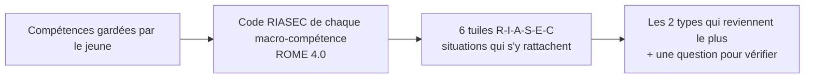

Quels tests du monde de l'orientation peuvent nourrir la [[Hackathon-IA/ideas/pierre/Fiche de préparation psy|fiche pour le psy]] ?

> [!success] Décision
> On **s'inspire du RIASEC**, à partir des codes officiels du ROME. On ne déduit **pas** de profil de personnalité (Big Five) à partir du récit.

## Comparaison

| Test | Ce qu'il mesure | Dans l'outil |
|---|---|---|
| **RIASEC (Holland)** | Intérêts professionnels : Réaliste, Investigateur, Artistique, Social, Entreprenant, Conventionnel | ✅ **Utilisé.** France Travail attribue un code RIASEC (majeur, parfois mineur) à **357 des 506** macro-compétences du ROME 4.0. Calcul direct, sans IA. |
| **Big Five (OCEAN)** | Personnalité : ouverture, conscienciosité, extraversion, agréabilité, stabilité émotionnelle | ❌ **Non.** C'est valide seulement via un questionnaire. Le déduire d'un récit, c'est du profilage peu fiable, contraire à « pas de score » et sensible. |
| **Savoirs-être ROME** | 16 comportements observables (empathie, autonomie, persévérance…) | ✅ Déjà dans la liste fermée, prouvés par une citation. C'est la passerelle honnête vers la personnalité. |
| **Aptitudes** | Raisonnement logique, verbal, spatial | ❌ Ça ne se tire pas d'un récit : c'est le rôle des questionnaires du Centre. |
| **MBTI** | Types de personnalité | ❌ Non validé scientifiquement. |

## Les 6 types RIASEC dans l'outil

| | Type | En mots simples (puce sur la carte) |
|---|---|---|
| **R** | Réaliste | Faire, réparer, construire |
| **I** | Investigateur | Chercher, comprendre |
| **A** | Artistique | Créer, imaginer, s'exprimer |
| **S** | Social | Aider, accompagner, transmettre |
| **E** | Entreprenant | Convaincre, organiser, mener |
| **C** | Conventionnel | Gérer, classer, être précis |

## Calcul

- Le type **majeur** place la situation dans la tuile, le type **mineur** l'y ajoute avec la mention « en partie ».
- Une tuile vide affiche : « Pas apparu dans ce récit, ce qui ne veut pas dire absent. »
- Il n'y a **ni pourcentage ni barre** : on montre seulement les situations qui le prouvent.

## Message pour le pitch

« Le Centre mesure les intérêts du jeune par questionnaire ; nous, on montre les intérêts qu'il a **déjà mis en pratique**, preuves à l'appui. Le psy compare les deux. »

## À vérifier

- [ ] Lire le Guide pratique du Centre (Discord, #ressources) : leur « profil d'intérêts » est-il bien du RIASEC ? _(à confirmer)_
